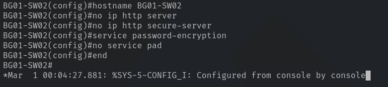

# Lab 01 - Cisco Catalyst 2960 Plus Configuration

| Property | Value |
| --- | --- |
| Switch | Cisco Catalyst WS-C2960+24TC-L |
| InventoryID | SW02 |
| Hostname | BG01-SW02 |
| IOS | 15.0(2)SE6 |
| Image | C2960-LANBASEK9-M |
| Access Interfaces | 24 FastEthernet |
| Uplink Interfaces | 2 GigabitEthernet |
| Management | SSHv2, restricted |

> [!NOTE]
> All rationale and explanations can be found at the bottom of the documentation, located in the [Rationale section](#rationale)

## Phase 1 - Configure Student Ports

## Phase 1 - Base System Configuration

The start of the setup will cover the `switch's identity and fundamental operating settings`. Following the base configuration, this documentation will cover the interface configuration, management security, and configuration-storage procedure for the **Cisco Catalyst 2960 Plus**.

### 1.1 Configure Switch Identity

Each switch will receive a unique hostname for identification during admin and troubleshooting workflows. The hostname will differ from the InventoryID by also including the bag in which the switch resides.

The naming convention is `BG##-SW##`, where `BG` identifies the deployment bag number, and `SW` defines the switch number. That way we will have an aggregation of bag location & switch number to quickly identify the switch in question. See [Rationale](#switch-hostname) for more details.

**Apply the following configuration commands**:

```cisco
enable
configure terminal
  hostname BG01-SW02
  no ip http server
  no ip http secure-server
  service password-encryption
  no service pad
end
```



## Rationale

### Switch Hostname

The main goal for the hostnames is to leverage the unique inventory ID, while also giving administrators an exact location of the hardware. The `InventoryID` can be found on any piece of equipment, with a white label.

We add the `bag UID` in front of the `InventoryID` to depict that exact location. The naming convention is short, easy to remember, and can be used for multiple use cases such as troubleshooting & documentation.

**Cisco 2960 hostname**:

```text
BG01-SW01
```
