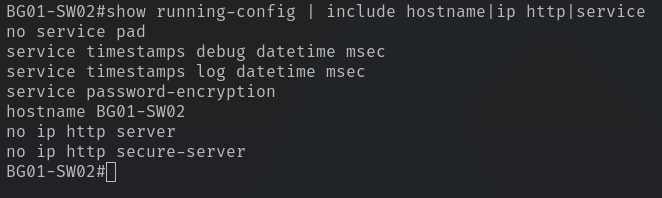

# Lab 01 - Cisco Catalyst 2960 Plus Configuration

| Property | Value |
| --- | --- |
| Switch | Cisco Catalyst WS-C2960+24TC-L |
| InventoryID | SW02 |
| Hostname | BG01-SW02 |
| IOS | 15.0(2)SE6 |
| Image | C2960-LANBASEK9-M |
| Access Interfaces | 24 FastEthernet |
| Uplink Interfaces | 2 GigabitEthernet |
| Management | SSHv2, restricted |

> [!NOTE]
> All rationale and explanations can be found inside of the `setup` directory at the file location [docs/labs/lab01/setup/rationale.md](./rationale.md)

## Phase 1 - Configure Student Ports

## Phase 1 - Base System Configuration

The start of the setup will cover the `switch's identity and fundamental operating settings`. Following the base configuration, this documentation will cover the interface configuration, management security, and configuration-storage procedure for the **Cisco Catalyst 2960 Plus**.

### 1.1 Configure Switch Identity

Each switch will receive a unique hostname for identification during admin and troubleshooting workflows. The hostname will differ from the InventoryID by also including the bag in which the switch resides.

The naming convention is `BG##-SW##`, where `BG` identifies the deployment bag number, and `SW` defines the switch number. That way we will have an aggregation of bag location & switch number to quickly identify the switch in question. See [Rationale](./rationale.md#hostname-configuration) for more details.

**Apply the following configuration commands**:

```cisco
en
conf t
  hostname BG01-SW02
  no ip http server
  no ip http secure-server
  service password-encryption
  no service pad
end
```

**No HTTP-based management [rationale link](./rationale.md#disable-http-based-management)**.


> [!NOTE]
> `service password-encryption` obscures applicable plaintext passwords within the configuration. This provides protection against casual exposure but is not a substitute for secure password hashing or SSH authentication.

### 1.2 Verify Base Configuration

```cisco
sh run | include hostname|ip http|service
```



## Phase 2 - VLAN and Interface Provisioning

### 2.1 Configure the VLAN baseline

For the duration of Lab 01, **three VLANS will be in use**:

| **VLAN #** | **Description** |
| --- | --- |
| `1` | Student-Facing VLAN (default) |
| `10` | TA Management VLAN |
| `999` | Unused Ports VLAN |

For more information as to why these three VLANs, please [visit the rationale section provided](./rationale.md#vlan-schema)

> [!NOTE]
> Students **will not** configure or interact with VLANs for the duration of lab 01.

**Create the VLANs**:

```cisco
configure terminal

  vlan 10
    name TA-MAN
  exit

  vlan 999
    name BRICK
  exit
```

> [!NOTE]
> VLAN 1 is already present by default with the base configuration of Cisco switches. There is no need for a VLAN 1 to be created.

### 2.2 Configure student-facing Interfaces

Ports `Fa0/1-5` provide connectivity for student endpoints. This is done in order to keep unnecessary unused ports inaccessible.

```cisco
int range fa0/1 - 5
  description LAB01-STUDENT
  switchport mode access
  switchport access vlan 1
  switchport nonegotiate
  spanning-tree portfast
  spanning-tree bpduguard enable
  no shutdown
exit
```

These interfaces will operate as **standard access ports**. The ports prevent trunk negotiation and keep all student endpoints within the same broadcast domain. For more information regarding student interface assignment configuration, please visit the [rationale page](./rationale.md#acc-configuration).

### 2.3 Disable Unused Interfaces

All unused FastEthernet ports and both GigabitEthernet uplinks will be administratively disabled. See [rationale section on disabled ports](./rationale.md#disabled-ports) for further information.

```cisco
int range fa0/6 - 22
 description ADMIN-DOWN
 switchport mode access
 switchport access vlan 999
 shutdown
exit

int range gi0/1 - 2
 description ADMIN-DOWN
 switchport mode access
 switchport access vlan 999
 shutdown
exit
```

Placing unused interfaces on `VLAN 999` **isolates them from the student LAN**. Shutdown prevents those interfaces from establishing network connectivity. This is especially important because deployment bags **must remain disconnected from UC's production infrastructure**.

### 2.4 Reserve the TA Management Interface

Port `Fa0/23` will provide dedicated physical access for authorized TAs, with several access control methods implemented such as MAC-based authorization which will be covered when configuring the management SVI. See [rationale section on the TA Management Interface](./rationale.md#ta-management-interface) for further information.

```cisco
interface FastEthernet0/23
  description TA-MAN
  switchport mode access
  switchport access vlan 10
  switchport nonegotiate
  spanning-tree portfast
  spanning-tree bpduguard enable
  no shutdown
exit
end
```

Port 23 is assigned to `VLAN 10`, separating TA management traffic from student-facing traffic on `VLAN 1`. This provides a dedicated management network while maintaining the existing student subnet. MAC-based port security and additional SSH restrictions will be configured in Phase 3.

At this stage, port 23 is **not yet restricted**.

### 2.5 Reserve the Game Server Interface

Port `Fa0/24` will provide dedicated connectivity for a locally hosted game server running [lan-games](https://github.com/kbennett2000/lan-games). The server will provide students with an interactive way to verify network connectivity while reinforcing foundational networking concepts.

```cisco
conf t
int fa0/24
  description LAB01-GAME-SERV
  switchport mode access
  switchport access vlan 1
  switchport nonegotiate
  spanning-tree portfast
  spanning-tree bpduguard enable
  no shutdown
exit
end
```

Port 24 is assigned to `VLAN 1`, placing the game server within the same broadcast domain as student endpoints. **This allows students to access the server directly without requiring inter-VLAN routing**.

The game server will operate entirely within the isolated lab network, requiring no connectivity to UC's production infrastructure or the public Internet during normal operation. See [rationale section on access ports](./rationale.md#access-port-configuration) for further information.

### 2.6 Verify Interface Configuration

**Run**:

```cisco
sh vl br
show int status
sh run | begin interface fa0/23
```

**show vlan brief**:


**show interface status**:


**show running-config | begin interface FastEthernet0/23**:


