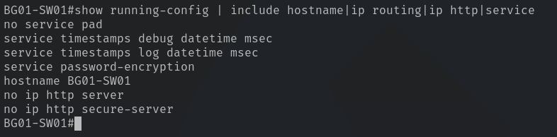
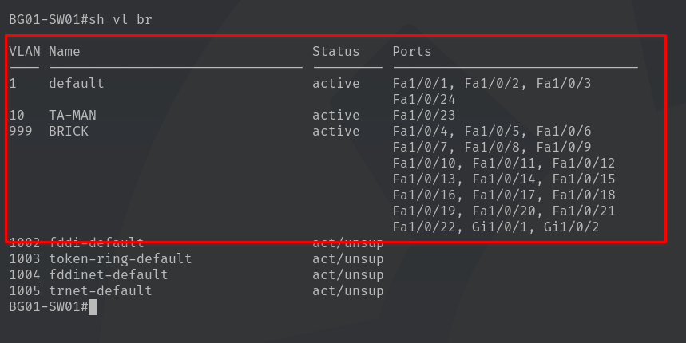
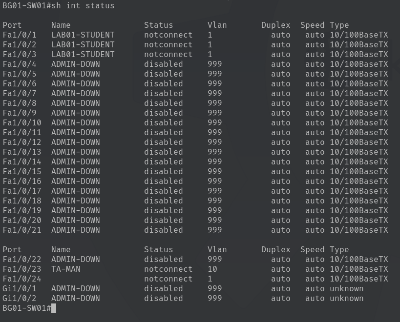
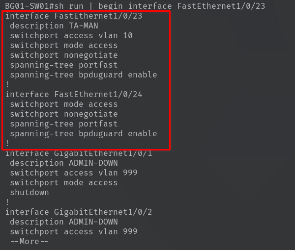
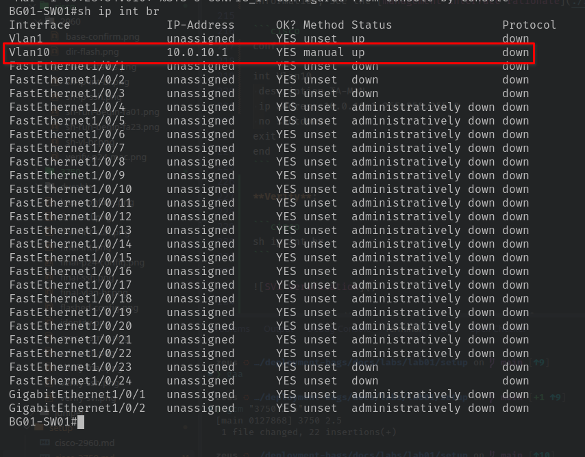
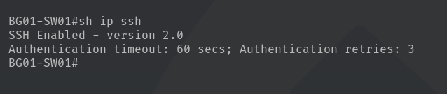

# Lab 01 - Cisco Catalyst 3750 Configuration

| Property | Value |
| --- | --- |
| Switch | Cisco Catalyst WS-C3750-24PS-S |
| InventoryID | SW01 |
| Hostname | BG01-SW01 |
| IOS | 12.2(55)SE10 |
| Image | C3750-IPServicesK9-M |
| Access Interfaces | 24 FastEthernet |
| Uplink Interfaces | 2 GigabitEthernet |
| Management | SSHv2, restricted |

> [!NOTE]
> All rationale and explanations can be found inside of the `setup` directory at the file location [docs/labs/lab01/setup/rationale.md](./rationale.md)

## Phase 1 - Configure Student Ports

## Phase 1 - Base System Configuration

The start of the setup will cover the `switch's identity and fundamental operating settings`. Following the base configuration, this documentation will cover the interface configuration, management security, and configuration-storage procedure for the **Cisco Catalyst 3750**.

### 1.1 Configure Switch Identity

Each switch will receive a unique hostname for identification during admin and troubleshooting workflows. The hostname will differ from the InventoryID by also including the bag in which the switch resides.

The naming convention is `BG##-SW##`, where `BG` identifies the deployment bag number, and `SW` defines the switch number. That way we will have an aggregation of bag location & switch number to quickly identify the switch in question. See [Rationale](./rationale.md#hostname-configuration) for more details.

**Apply the following configuration commands**:

```cisco
en
conf t
  hostname BG01-SW01
  no ip http server
  no ip http secure-server
  service password-encryption
  no service pad
  no ip routing
end
```

**No HTTP-based management [rationale link](./rationale.md#disable-http-based-management)**.

> [!NOTE]
> `service password-encryption` obscures applicable plaintext passwords within the configuration. This provides protection against casual exposure but is not a substitute for secure password hashing or SSH authentication.

Although the Catalyst 3750 supports Layer 3 routing, routing is disabled for Lab 01 because all student endpoints reside within a single subnet. HTTP-based management is also disabled to reduce unnecessary management services and the device's attack surface.

> [!NOTE]
> `service password-encryption` obscures applicable plaintext passwords within the configuration. This provides protection against casual exposure but is not a substitute for secure password hashing or SSH authentication.

### 1.2 Verify Base Configuration

```cisco
show running-config | include hostname|ip routing|ip http|service
```



## Phase 2 - VLAN and Interface Provisioning

### 2.1 Configure the VLAN baseline

For the duration of Lab 01, **three VLANS will be in use**:

| **VLAN #** | **Description** |
| --- | --- |
| `1` | Student-Facing VLAN (default) |
| `10` | TA Management VLAN |
| `999` | Unused Ports VLAN |

For more information as to why these three VLANs, please [visit the rationale section provided](./rationale.md#vlan-schema)

> [!NOTE]
> Students **will not** configure or interact with VLANs for the duration of lab 01.

**Create the VLANs**:

```cisco
conf t

  vlan 10
    name TA-MAN
  exit

  vlan 999
    name BRICK
  exit
```

> [!NOTE]
> VLAN 1 is already present by default with the base configuration of Cisco switches. There is no need for a VLAN 1 to be created.

### 2.2 Configure student-facing Interfaces

Ports `Fa1/0/1-3` provide connectivity for student endpoints. This is done in order to keep unnecessary unused ports inaccessible.

```cisco
int range fa1/0/1 - 3
  description LAB01-STUDENT
  sw mode access
  sw access vlan 1
  sw nonegotiate
  sp portfast
  sp bpduguard enable
  no shutdown
exit
```

These interfaces will operate as **standard access ports**. The ports prevent trunk negotiation and keep all student endpoints within the same broadcast domain. For more information regarding student interface assignment configuration, please visit the [rationale page](./rationale.md#acc-configuration).

### 2.3 Disable Unused Interfaces

All unused FastEthernet ports and both GigabitEthernet uplinks will be administratively disabled. See [rationale section on disabled ports](./rationale.md#disabled-ports) for further information.

```cisco
int range fa1/0/4 - 22
 description ADMIN-DOWN
 sw mode access
 sw access vlan 999
 shutdown
exit

int range gi1/0/1 - 2
 description ADMIN-DOWN
 sw mode access
 sw access vlan 999
 shutdown
exit
```

Placing unused interfaces on `VLAN 999` **isolates them from the student LAN**. Shutdown prevents those interfaces from establishing network connectivity. This is especially important because deployment bags **must remain disconnected from UC's production infrastructure**.

### 2.4 Reserve the TA Management Interface

Port `Fa1/0/23` will provide dedicated physical access for authorized TAs, with several access control methods implemented such as MAC-based authorization which will be covered when configuring the management SVI. See [rationale section on the TA Management Interface](./rationale.md#ta-management-interface) for further information.

```cisco
conf t

int FastEthernet1/0/23
  description TA-MAN
  sw mode access
  sw access vlan 10
  sw nonegotiate
  sp portfast
  sp bpduguard enable
  no shutdown
exit
end
```

Port 23 is assigned to `VLAN 10`, separating TA management traffic from student-facing traffic on `VLAN 1`. This provides a dedicated management network while maintaining the existing student subnet. MAC-based port security and additional SSH restrictions will be configured in Phase 3.

At this stage, port 23 is **not yet restricted**.

### 2.5 Reserve the Game Server Interface

Port `Fa1/0/24` will provide dedicated connectivity for a locally hosted game server running [lan-games](https://github.com/kbennett2000/lan-games). The server will provide students with an interactive way to verify network connectivity while reinforcing foundational networking concepts.

```cisco
conf t
int fa1/0/24
  description LAB01-GAME-SERV
  sw mode access
  sw access vlan 1
  sw nonegotiate
  sp portfast
  sp bpduguard enable
  no shutdown
exit
end
```

Port 24 is assigned to `VLAN 1`, placing the game server within the same broadcast domain as student endpoints. **This allows students to access the server directly without requiring inter-VLAN routing**.

The game server will operate entirely within the isolated lab network, requiring no connectivity to UC's production infrastructure or the public Internet during normal operation. See [rationale section on access ports](./rationale.md#access-port-configuration) for further information.

### 2.6 Verify Interface Configuration

**Run**:

```cisco
sh vl br
show int status
sh run | begin interface fa1/0/23
```

**show vlan brief**:



**show interface status**:



**show running-config | begin interface FastEthernet0/23**:



## Phase 3 - Management Interface & Access Security

**Phase 3 establishes**:

* switch management IP
* Enables SSH administration
* Restricts management access to authorized TA devices.

### 3.1 Configure the Management Interface

The Catalyst 3750 uses a **Switched Virtual Interface (SVI)** to provide IP connectivity for switch management. `VLAN 10` will host this interface. For further information, see the [management interface rationale](./rationale.md#ta-management-interface).

```cisco
conf t

int Vlan10
 description TA-MAN
 ip address 10.0.10.1 255.255.255.0
 no shutdown
exit
end
```

**Verify**:

```cisco
sh ip int br
```



VLAN 10 should display `10.0.10.1`. Its protocol status **may remain down** until at least one active `VLAN 10` port establishes a physical connection.

### 3.2 Configure SSH Authentication

**Administrative access will require a local username and password**.

```cisco
conf t

ip domain-name dep-bags.local
enable secret <ENABLE_PASSWORD>
username ta privilege 15 secret <TA_PASSWORD>

crypto key generate rsa
```

Use distinct, strong passwords for the enable secret and TA account. Replace the placeholders with actual values; **DO NOT include credentials in published documentation**.

When prompted for the key modulus, enter `2048` if supported.

**Then**:

```cisco
ip ssh version 2
ip ssh time-out 60
ip ssh authentication-retries 3

line vty 0 15
 login local
 transport input ssh
 exec-timeout 10 0
exit

end
```

> [!NOTE]
> The 10-minute inactivity timeout terminates abandoned management sessions, while limiting authentication retries reduces repeated unauthorized login attempts.

**Verify**:

```cisco
sh ip ssh
```

**Expected output**:



### 3.3 Restrict SSH to Authorized TA IP Addresses

SSH authentication alone **does not prevent students from attempting to access the management service**. A standard `access control list (ACL)` will restrict incoming VTY connections to approved TA source addresses.

**We will reserve**:

| Device | Address |
| --- | --- |
| Switch | `10.0.10.1` |
| Primary TA Workstation | `10.0.10.10` |

```cisco
conf t

access-list 10 remark TA-SSH
access-list 10 permit host 10.0.10.10

line vty 0 15
 access-class 10 in
exit

end
```

The ACL includes an **implicit deny for every other source address**.

> [!CAUTION]
> Source IP restrictions do not prevent IP address spoofing. They provide an additional security layer alongside SSH authentication and physical port security.
