# Lab 01 - Cisco Catalyst 3750 Configuration

| Property | Value |
| --- | --- |
| Switch | Cisco Catalyst WS-C3750-24PS-S |
| InventoryID | SW01 |
| Hostname | BG01-SW01 |
| IOS | 12.2(55)SE10 |
| Image | C3750-IPServicesK9-M |
| Access Interfaces | 24 FastEthernet |
| Uplink Interfaces | 2 GigabitEthernet |
| Management | SSHv2, restricted |

> [!NOTE]
> All rationale and explanations can be found inside of the `setup` directory at the file location [docs/labs/lab01/setup/rationale.md](./rationale.md)

## Phase 1 - Configure Student Ports

## Phase 1 - Base System Configuration

The start of the setup will cover the `switch's identity and fundamental operating settings`. Following the base configuration, this documentation will cover the interface configuration, management security, and configuration-storage procedure for the **Cisco Catalyst 3750**.

### 1.1 Configure Switch Identity

Each switch will receive a unique hostname for identification during admin and troubleshooting workflows. The hostname will differ from the InventoryID by also including the bag in which the switch resides.

The naming convention is `BG##-SW##`, where `BG` identifies the deployment bag number, and `SW` defines the switch number. That way we will have an aggregation of bag location & switch number to quickly identify the switch in question. See [Rationale](./rationale.md#hostname-configuration) for more details.

**Apply the following configuration commands**:

```cisco
en
conf t
  hostname BG01-SW01
  no ip http server
  no ip http secure-server
  service password-encryption
  no service pad
  no ip routing
end
```

**No HTTP-based management [rationale link](./rationale.md#disable-http-based-management)**.

> [!NOTE]
> `service password-encryption` obscures applicable plaintext passwords within the configuration. This provides protection against casual exposure but is not a substitute for secure password hashing or SSH authentication.

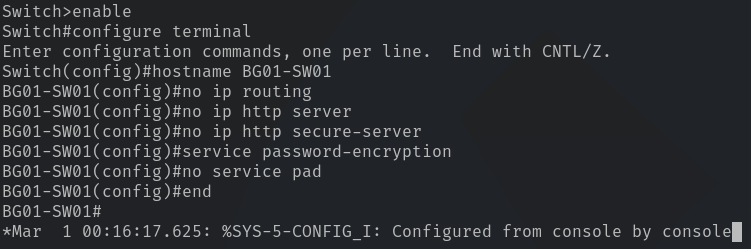

Although the Catalyst 3750 supports Layer 3 routing, routing is disabled for Lab 01 because all student endpoints reside within a single subnet. HTTP-based management is also disabled to reduce unnecessary management services and the device's attack surface.

> [!NOTE]
> `service password-encryption` obscures applicable plaintext passwords within the configuration. This provides protection against casual exposure but is not a substitute for secure password hashing or SSH authentication.

### 1.2 Verify Base Configuration

```cisco
show running-config | include hostname|ip routing|ip http|service
```


## Phase 2 - VLAN and Interface Provisioning

### 2.1 Configure the VLAN baseline

For the duration of Lab 01, **three VLANS will be in use**:

| **VLAN #** | **Description** |
| --- | --- |
| `1` | Student-Facing VLAN (default) |
| `10` | TA Management VLAN |
| `999` | Unused Ports VLAN |

For more information as to why these three VLANs, please [visit the rationale section provided](./rationale.md#vlan-schema)

> [!NOTE]
> Students **will not** configure or interact with VLANs for the duration of lab 01.

**Create the VLANs**:

```cisco
conf t

  vlan 10
    name TA-MAN
  exit

  vlan 999
    name BRICK
  exit
```

> [!NOTE]
> VLAN 1 is already present by default with the base configuration of Cisco switches. There is no need for a VLAN 1 to be created.

### 2.2 Configure student-facing Interfaces

Ports `Fa1/0/1-3` provide connectivity for student endpoints. This is done in order to keep unnecessary unused ports inaccessible.

```cisco
int range fa1/0/1 - 3
  description LAB01-STUDENT
  sw mode access
  sw access vlan 1
  sw nonegotiate
  sp portfast
  sp bpduguard enable
  no shutdown
exit
```

These interfaces will operate as **standard access ports**. The ports prevent trunk negotiation and keep all student endpoints within the same broadcast domain. For more information regarding student interface assignment configuration, please visit the [rationale page](./rationale.md#acc-configuration).

### 2.3 Disable Unused Interfaces

All unused FastEthernet ports and both GigabitEthernet uplinks will be administratively disabled. See [rationale section on disabled ports](./rationale.md#disabled-ports) for further information.

```cisco
int range fa1/0/4 - 22
 description ADMIN-DOWN
 sw mode access
 sw access vlan 999
 shutdown
exit

int range gi1/0/1 - 2
 description ADMIN-DOWN
 sw mode access
 sw access vlan 999
 shutdown
exit
```

Placing unused interfaces on `VLAN 999` **isolates them from the student LAN**. Shutdown prevents those interfaces from establishing network connectivity. This is especially important because deployment bags **must remain disconnected from UC's production infrastructure**.

### 2.4 Reserve the TA Management Interface

Port `Fa1/0/23` will provide dedicated physical access for authorized TAs, with several access control methods implemented such as MAC-based authorization which will be covered when configuring the management SVI. See [rationale section on the TA Management Interface](./rationale.md#ta-management-interface) for further information.

```cisco
conf t

int FastEthernet1/0/23
  description TA-MAN
  sw mode access
  sw access vlan 10
  sw nonegotiate
  sp portfast
  sp bpduguard enable
  no shutdown
exit
end
```

Port 23 is assigned to `VLAN 10`, separating TA management traffic from student-facing traffic on `VLAN 1`. This provides a dedicated management network while maintaining the existing student subnet. MAC-based port security and additional SSH restrictions will be configured in Phase 3.

At this stage, port 23 is **not yet restricted**.

### 2.5 Reserve the Game Server Interface

Port `Fa1/0/24` will provide dedicated connectivity for a locally hosted game server running [lan-games](https://github.com/kbennett2000/lan-games). The server will provide students with an interactive way to verify network connectivity while reinforcing foundational networking concepts.

```cisco
conf t
int fa1/0/24
  description LAB01-GAME-SERV
  sw mode access
  sw access vlan 1
  sw nonegotiate
  sp portfast
  sp bpduguard enable
  no shutdown
exit
end
```

Port 24 is assigned to `VLAN 1`, placing the game server within the same broadcast domain as student endpoints. **This allows students to access the server directly without requiring inter-VLAN routing**.

The game server will operate entirely within the isolated lab network, requiring no connectivity to UC's production infrastructure or the public Internet during normal operation. See [rationale section on access ports](./rationale.md#access-port-configuration) for further information.

---

### 2.5 Verify Interface Configuration

**Run**:

```cisco
show vlan brief
show interface status
show running-config | begin interface FastEthernet1/0/24
```

**Expected output**:

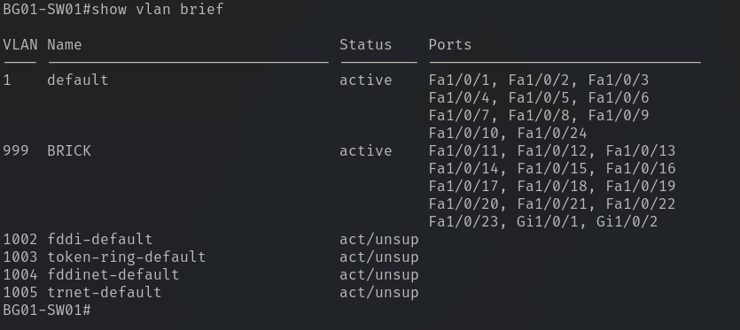

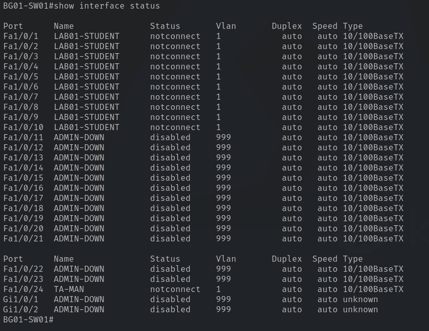

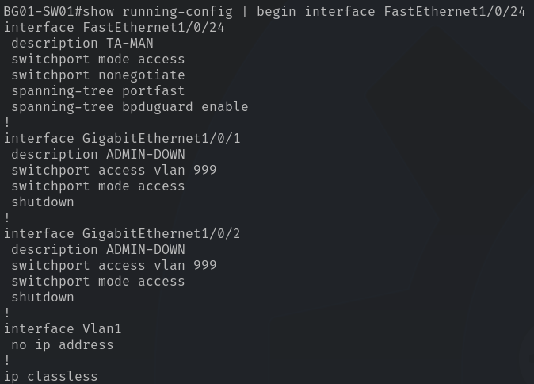

## Phase 3 - Management Interface & Access Security

**Phase 3 establishes**:

* switch management IP
* Enables SSH administration
* Restricts management access to authorized TA devices.

Although management and student traffic share VLAN 1, multiple controls are implemented to limit unauthorized access. The switch will use `10.0.0.1/24`, allowing students to verify connectivity using ICMP while TAs retain administrative access through port 24.

### 3.1 Configure the Management Interface

The Catalyst 3750 uses a **Switched Virtual Interface (SVI)** to provide IP connectivity for switch management. `VLAN 1` will host this interface because **Lab 01 operates on a single subnet**.

```cisco
configure terminal

interface Vlan1
 description LAB01-MAN
 ip address 10.0.0.1 255.255.255.0
 no shutdown
exit
end
```

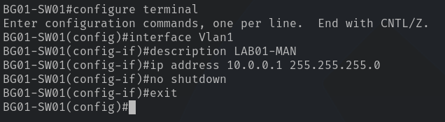

No default gateway is necessary because the deployment bag is isolated and all endpoints reside within `10.0.0.0/24`.

**Verify**:

```cisco
show ip interface brief
```

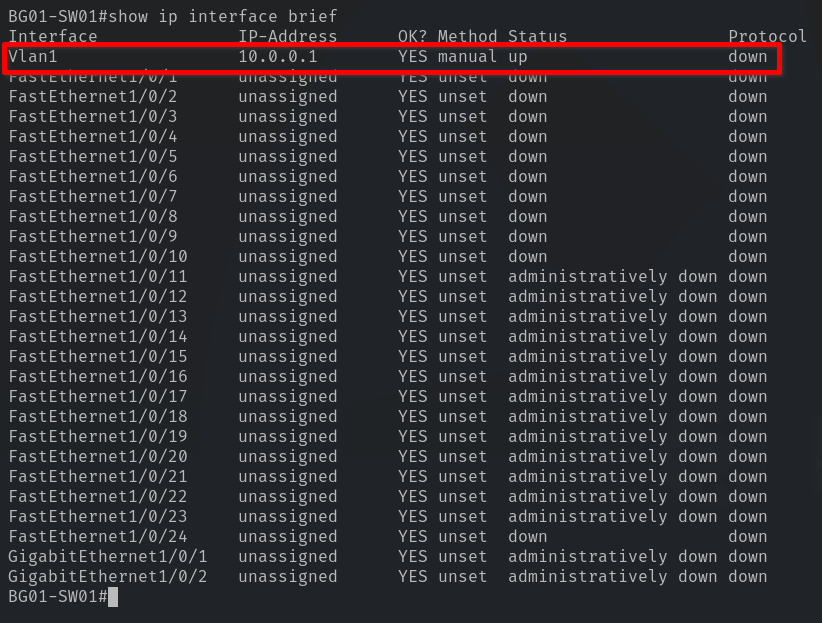

VLAN 1 should display `10.0.0.1`. Its protocol status **may remain down** until at least one active VLAN 1 port establishes a physical connection.

### 3.2 Configure SSH Authentication

**Administrative access will require a local username and password**.

```cisco
configure terminal

ip domain-name dep-bags.local
enable secret <ENABLE_PASSWORD>
username ta privilege 15 secret <TA_PASSWORD>

crypto key generate rsa
```

When prompted for the key modulus, enter `2048` if supported.

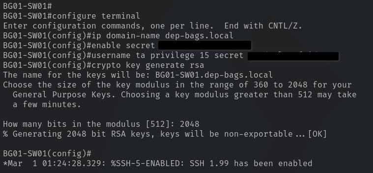

**Then**:

```cisco
ip ssh version 2
ip ssh time-out 60
ip ssh authentication-retries 3

line vty 0 15
 login local
 transport input ssh
 exec-timeout 10 0
exit

end
```

Use distinct, strong passwords for the enable secret and TA account. Replace the placeholders with actual values; **DO NOT include credentials in published documentation**.

> [!NOTE]
> The 10-minute inactivity timeout terminates abandoned management sessions, while limiting authentication retries reduces repeated unauthorized login attempts.

**Verify**:

```cisco
show ip ssh
```

**Expected output**:

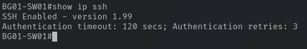

### 3.3 Restrict SSH to Authorized TA IP Addresses

SSH authentication alone **does not prevent students from attempting to access the management service**. A standard `access control list (ACL)` will restrict incoming VTY connections to approved TA source addresses.

**We will reserve**:

| Device | Address |
| --- | --- |
| Switch | `10.0.0.1` |
| Primary TA Workstation | `10.0.0.250` |

```cisco
configure terminal

access-list 10 remark AUTH-TA-SSH
access-list 10 permit host 10.0.0.250

line vty 0 15
 access-class 10 in
exit

end
```

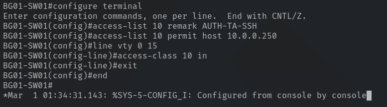

The ACL includes an **implicit deny for every other source address**. This restricts SSH access without blocking ICMP requests to the switch, preserving the student connectivity exercise.

> [!CAUTION]
> Source IP restrictions do not prevent IP address spoofing. They provide an additional security layer alongside SSH authentication and physical port security.

### 3.4 Configure Port 24 MAC-Based Security

`FastEthernet1/0/24` serves as the **dedicated TA management connection**. Static MAC-based port security restricts access to approved Ethernet adapters & NICs.

For this setup, we'll allow up to **three authorized MAC addresses**. Before applying the configuration, **record the wired Ethernet MAC addresses of the authorized TA devices**. Do not use their Wi-Fi MAC addresses.

```cisco
configure terminal

interface FastEthernet1/0/24
 switchport port-security maximum 3
 switchport port-security violation restrict
 switchport port-security mac-address AAAA.BBBB.CCCC
 switchport port-security mac-address DDDD.EEEE.FFFF
 switchport port-security mac-address GGGG.HHHH.IIII
 switchport port-security
exit

end
```

Replace both MAC placeholders with Cisco-formatted addresses, such as `AAAA.BBBB.CCCC`.

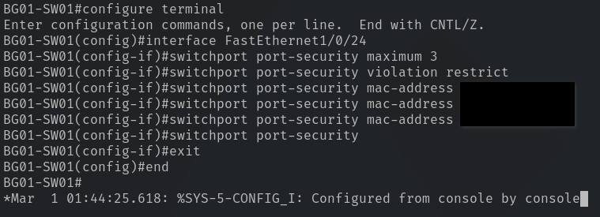

#### Port Security Behavior

| Setting | Function |
| --- | --- |
| Maximum 3 | Limits the number of authorized MAC addresses |
| Static MAC Addresses | Defines authorized TA Ethernet adapters & NIC's |
| Violation Restrict | Drops frames from unauthorized source MAC addresses |
| Port Security Enabled | Enforces configured restrictions |

The `restrict` violation mode was selected instead of `shutdown` to prevent an unauthorized connection from forcing the management port into an error-disabled state. Violations are still recorded through switch counters and supported logging.

> [!CAUTION]
> MAC addresses can be spoofed, so this mechanism is an access restriction rather than strong device authentication.

**Verify**:

```cisco
show port-security interface FastEthernet1/0/24
show port-security address
```

**Expected output**:

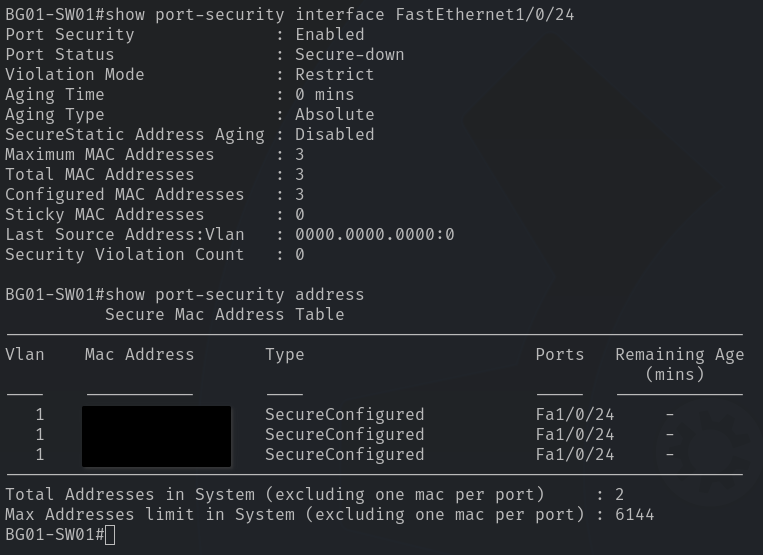

### 3.5 Validate Management Access

Before deeming the configuration valid, perform the following tests.

| Test | Expected Output |
| --- | --- |
| TA workstation pings `10.0.0.1` | Success |
| TA workstation SSH to `10.0.0.1` | Success |
| Unauthorized source IP attempts to SSH | Rejected |
| Unauthorized MAC connects to port 24 | Frames restricted |
| Student pings `10.0.0.1` | Success |
| Student endpoint attempts to SSH | Rejected |

The TA workstation must use its reserved management address and an authorized wired Ethernet adapter.

**For SSH validation**:

```bash
ssh ta@10.0.0.1
```

> [!WARNING]
> **Legacy SSH Compatibility:** The Catalyst 3750 runs Cisco IOS 12.2, which may rely on SSH algorithms disabled by modern OpenSSH clients. PuTTY is recommended for administrative connections if the default SSH client cannot negotiate a compatible session. Legacy algorithms should only be enabled when necessary within the isolated lab environment.

### 3.6 Management Security Summary

Administrative access is protected through multiple security controls intended to prevent unauthorized switch configuration while preserving student connectivity.

* **Physical Access**: Port 24 is designated for TA management with static port security restricting access to three authorized MAC addresses.
* **IP Based Restrictions**: An Access Control List (ACL) permits SSH connections only from the designated TA workstation IP `(10.0.0.250)`.
* **Authentication**: SSHv2 requires authenticated credentials and encrypts all management sessions. Telnet & HTTP-based management are disabled.
* **Session Security**: Authentication retries and idle session timeouts limit repeated login attempts and unattended admin sessions.
* **Network Isolation**: The deployment bag environments operate independently of the UC production network. Unused switch interfaces are administratively disabled and assigned to VLAN 999.

> [!IMPORTANT]
> Security Considerations: Because student and management interfaces share VLAN 1, SSH is not physically restricted to port 24. A device connected to a student port could potentially use the authorized source IP to reach the SSH service, but valid administrative credentials would still be required. MAC addresses and IP addresses can also be spoofed. These controls provide layered protection appropriate for the isolated instructional environment, rather than complete management-plane

## Phase 4 - Configuration Persistence & Recovery

This phase establishes a persistent configuration baseline that allows TAs to restore the switch without manually reentering commands.

Our preferred approach is to store named lab configurations directly in the switch's internal flash storage, with independent backups maintained outside the device.

### 4.1 Save the Active Configuration

Changes to the running configuration are not automatically preserved across a reboot. **Save the completed Lab 01 configuration**:

```cisco
copy running-config startup-config
```

Press Enter to accept the default destination filename. **This establishes Lab 01 as the switch's normal startup configuration**.

### 4.2 Create the Lab 01 Configuration Profile

The Catalyst 3750 supports storing additional configuration files in its internal flash storage. These files can be used as predefined lab profiles without relying on an external provisioning script.

**Create the Lab 01 profile**:

```cisco
copy running-config flash:lab01.cfg
```

**Verify**:

```cisco
dir flash:
```

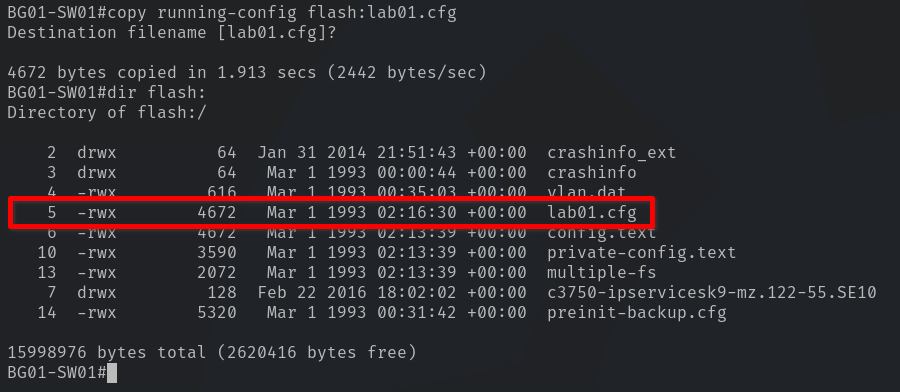

### 4.3 Restore a Stored Lab Configuration

To restore Lab 01, **copy its configuration file into the startup configuration and reload the switch**:

```cisco
copy flash:lab01.cfg startup-config
reload
```

If prompted to save the current running configuration before reloading, select `no`. Otherwise, the current configuration could overwrite the profile selected for restoration. The switch will then load the saved Lab 01 configuration.

> [!IMPORTANT]
> VLAN Persistence: On this Catalyst platform, VLAN definitions may also be stored in flash:vlan.dat. Restoring a .cfg file does not necessarily replace the VLAN database. Lab profiles that introduce different VLANs will require a corresponding VLAN restoration or cleanup procedure. The reset process must be tested before using it across different labs.

### 4.4 Establish External Configuration Backups

Although internal flash storage enables local recovery, it should not be the sole copy of the switch configuration.

Each verified lab profile should also be retained in the project's version-controlled configuration repository, excluding passwords, credential hashes, private keys, and other secrets.

```text
configs/
  3750/
    lab01.cfg
    lab02.cfg
    lab03.cfg
  2960/
    lab01.cfg
    lab02.cfg
    lab03.cfg
  juniper/
    lab01.conf
    lab02.conf
    lab03.conf
```

#### 4.4.1 Display Complete Configuration

**On the switch**:

```cisco
terminal length 0
show running-config
```

`terminal length 0` disables output pagination, allowing the entire configuration to display without `--More--` prompts. **Copy the configuration output from your terminal**.

#### 4.4.2 Save the Configuration Locally

In the Git repository, create a file under /configs/cisco/3750/lab01.cfg`. Paste the configuration.

#### 4.4.3 Sanitize Credentials

Important: Don't commit the raw switch configuration.

Cisco configurations can contain password hashes and other sensitive information. Even though passwords aren't displayed in plaintext, those hashes can potentially be cracked.

Review the file for:

* `enable secret` - Replace its hash with a placeholder
* `username ... secret` - Replace password hashes with placeholders
* Any embedded private key material or sensitive information

For example, a sanitized repository entry might look like:

```cisco
enable secret <ENABLE_SECRET>
username ta privilege 15 secret <TA_SECRET>
```

> [!IMPORTANT]
> This sanitized file is a configuration template, not a directly deployable backup. An exact restoration is located on the thumb drive located in the bags during downtime.

### 4.5 Verify Configuration Persistence

After saving, **confirm the active configuration is stored correctly**:

```cisco
show startup-config
dir flash:
```

## Phase 5 - Final Validation & Deployment Readiness

The final phase verifies that the Catalyst 3750 operates as designed, enforces administrative access restrictions, and retains its configuration after a reboot.

Successful validation establishes `lab01.cfg` as the canonical configuration baseline for Deployment Bag 01.

### 5.1 Verify Switch Configuration

Before connecting student endpoints, confirm the VLAN assignments, interface states, and management configuration.

```cisco
show vlan brief
show interfaces status
show ip interface brief
show ip ssh
show access-lists 10
show port-security interface FastEthernet1/0/24
```

**Verify the following**:

| Component | Expected configuration |
| --- | --- |
| Student interfaces | `Fa1/0/1–10`, `VLAN 1`, `enabled` |
| Unused interfaces | `Fa1/0/11–23`, `VLAN 999`, `shutdown` |
| Gigabit uplinks | `Gi1/0/1–2`, `shutdown` |
| TA management port | `Fa1/0/24`, `VLAN 1`, `enabled` |
| Switch management IP | `10.0.0.1/24` |
| SSH | Version 2.0 |
| VTY access | `ACL 10`, TA IP `10.0.0.250` |
| Port security | Three authorized static MAC addresses |

**Expected outputs**:

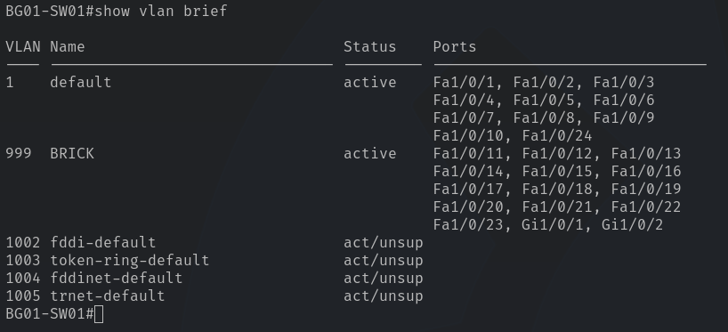

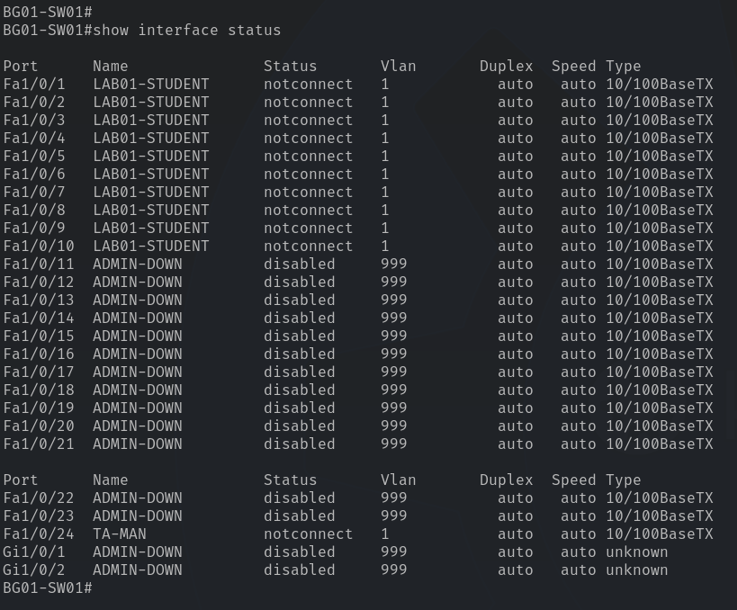

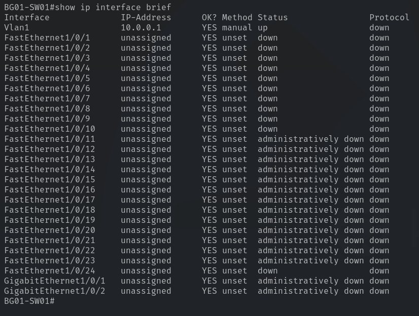

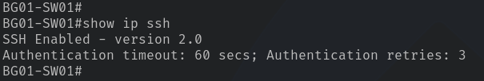

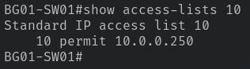

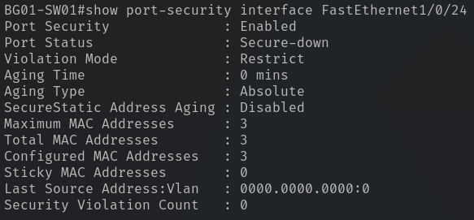

### 5.2 Validate Student Connectivity

Connect two endpoints to student ports 1 and 2. **Configure their Ethernet adapters using the following addresses**:

| Setting | Endpoint A | Endpoint B |
| Ipv4 Address | `10.0.0.10` | `10.0.0.11` |
| Subnet Mask | `255.255.255.0` | `255.255.255.0` |
| Default Gateway | null | null

#### Test 1 — Switch Connectivity

**On both endpoints**:

```bash
ping 10.0.0.1
```

**Expected**: Successful ICMP echo replies from the switch/

#### Test 2 — Peer Connectivity

**On Endpoint A**:

```bash
ping 10.0.0.11
```

**Expected**: ICMP communication may succeed or fail depending on the endpoint firewall configuration. An unsuccessful ping is not automatically considered a network failure.

#### Test 3 — ARP Resolution

On Endpoint A:

```bash
arp -a
```

Locate the entry corresponding to `10.0.0.11`. Successful ARP resolution demonstrates that Endpoint A discovered Endpoint B's MAC address through the local Ethernet network, even if inbound ICMP is blocked.

If ARP resolution fails, verify addressing, physical connectivity, and interface selection before attributing the failure to Windows Firewall.

### 5.3 Validate Administrative Access

Connect an authorized TA workstation to port 24 with the following Ethernet configuration:

| Property | Value |
| --- | --- |
| Ipv4 Address | `10.0.0.250` |
| Subnet Mask | `255.255.255.0` |
| Default Gateway | null |

**Verify the following**:

* [ ] Authorized workstation can ping `10.0.0.1`
* [ ] Authorized workstation can authenticate via SSH
* [ ] Unauthorized source IP cannot establish SSH access
* [ ] Unauthorized MAC address is rejected on port 24

> [!NOTE]
> For SSH testing, use PuTTY if the modern OpenSSH client cannot negotiate compatible algorithms with the switch's legacy IOS implementation.
