# Lab 01 - Juniper EX3300 PoE+ Configuration

| Property | Value |
| --- | --- |
| Switch | Juniper EX3300-24P |
| Inventory IDs | SW03, SW04 |
| Hostnames | BG02-SW03, BG02-SW04 |
| JunOS Version | 12.3R6.6 |
| Chassis Serial # | GE0214504728 |
| Access Interfaces | 24 GigabitEthernet |
| Uplink Interfaces | 4 10GE SFP+ |
| Management | SSHv2, restricted |

## Phase 1 - Base System Configuration

The start of the setup will cover the `switch's identity and fundamental operating settings`. Following the base configuration, this documentation will cover the interface configuration, management security, and configuration-storage procedure for the **Juniper EX3300**.

### 1.1 Configure Switch Identity

Each switch will receive a unique hostname for identification during admin and troubleshooting workflows. The hostname will differ from the InventoryID by also including the bag in which the switch resides.

The naming convention is `BG##-SW##`, where `BG` identifies the deployment bag number, and `SW` defines the switch number. That way we will have an aggregation of bag location & switch number to quickly identify the switch in question.

Dependant on which switch it being set up, **use the hostname `BG02-SW03` or `BG02-SW04`:

```juniper
cli
configure
set system host-name BG02-SW03
set system domain-name dep-bags.local
delete system services web-management
```


> [!NOTE]
> The `delete system services web-management` command is needed only if that stanza exists; a message that the statement does not exist is harmless. Likewise, do not enable Telnet. JunOS uses password hashes rather than Cisco `service password-encryption`, and no Cisco `enable secret` equivalent is needed for a `super-user` account. Routing is not configured for Lab 01; do not configure IP routing on additional VLAN interfaces or a default route.

### 1.2 Configure Root Authentication

**JunOS requires root authentication to be configured before the first configuration commit can succeed**. Unlike Cisco IOS, where administrative privileges are controlled through enable mode, JunOS uses user accounts with assigned login classes.

**While in configuration mode**:

```juniper
set system root-authentication plain-text-password
```

When prompted, enter and confirm a strong password. The password will not be displayed while typing.

> [!IMPORTANT]
> Root authentication is mandatory on an initially unconfigured Juniper EX3300. Attempting to commit without it will produce the error `Missing mandatory statement: 'root-authentication'`.

---

> [!CAUTION]
> Do not include plaintext credentials or password hashes in published documentation. Store administrative credentials using the project's approved secure credential-storage process.

### 1.3 Verify Base Configuration

Before committing, **inspect the pending system configuration**:

```juniper
show system host-name
show system domain-name
show system services
show | compare
```

**Expected output**:


**Verify that**:

* The `hostname` matches the assigned switch: `BG02-SW03` or `BG02-SW04`
* The domain name is `dep-bags.local`
* HTTP and HTTPS web management services are not enabled
* Root authentication has been configured

**Validate the pending configuration**:

```juniper
commit check
```

**Expected output**:

```juniper
configuration check succeeds
```

If the configuration is correct, confirm the commit:

```juniper
commit
```

**Expected output**:

```juniper
commit complete
```


> [!NOTE]
> Unlike Cisco IOS, **JunOS does not maintain independently edited running and startup configurations**. Changes are made to a candidate configuration and activated using commit. Successfully committed changes persist across a reboot.

## Phase 2 - VLAN and Interface Provisioning

Now that Phase 1 is complete, we'll configure the EX3300's Layer 2 switching environment. We'll follow the same architecture as your Cisco 3750

| Purpose | Juniper EX3300 Interfaces | VLAN |
| --- | --- | --- |
| Student access | `ge0/0/0 - 9` | 1 |
| Disabled / Bricked | `ge0/0/10 - 22` | 999 |
| TA management | `ge0/0/23` | 1 |
| Disabled uplinks | `Four SFP+` | 999 where applicable |

### 2.1 Configure VLAN Baseline

`VLAN 1` serves as the primary student `LAN for Lab 01`. `VLAN 999`, named `BRICK`, isolates unused switch interfaces from the student network. **Both VLANs must remain local to the deployment bag**, without any connection to the UC production infrastructure.

**Create and verify VLAN 999**:

```juniper
set vlans BRICK vlan-id 999
show vlans
show | compare
```

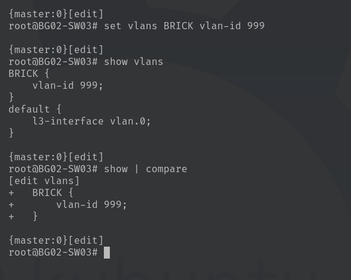

**Validate and commit**:

```juniper
commit check
commit
```

**Confirm VLAN 999 exists**:

```juniper
run show vlans
```

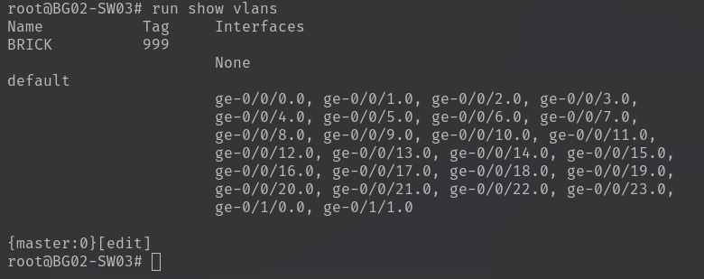

Verify that `BRICK` is present with `VLAN ID 999`. The VLAN does not need active interfaces yet; those will be assigned in Section 2.3.

> [!NOTE]
> Students will not configure VLANs during Lab 01. **VLAN 999 is reserved for administratively disabled interfaces** and should not be assigned to student endpoints.

### 2.2 Configure Student-Facing Interfaces

Now we'll configure the **first 10 Gigabit Ethernet interfaces** on the Juniper EX3300-24P for student connectivity.

These interfaces correspond to Fa1/0/1–10 on your Cisco Catalyst 3750. They will operate as standard Layer 2 access ports on VLAN 1, with Rapid Spanning Tree Protocol (RSTP) protection.

#### 2.2.1 Configure Access Ports

**Create an *interface range* to avoid configuring all ten ports individually**.

```juniper
set interfaces interface-range STUDENTS member-range ge-0/0/0 to ge-0/0/9
set interfaces interface-range STUDENTS description LAB01-STUDENT
set interfaces interface-range STUDENTS unit 0 family ethernet-switching port-mode access
set interfaces interface-range STUDENTS unit 0 family ethernet-switching vlan members default
```

**Verify pending configuration**:

```juniper
show interfaces interface-range STUDENTS
show | compare
```

**Expected output**:

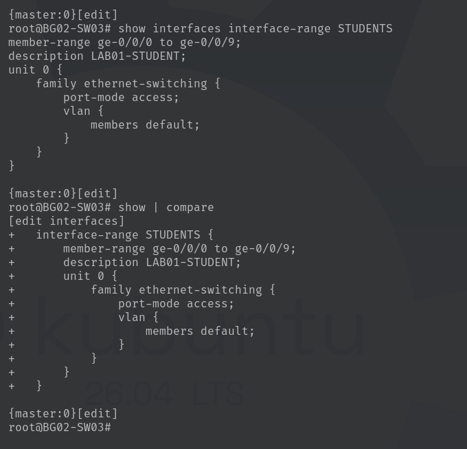

#### 2.2.2 Configure RSTP Edge Ports

Cisco's `spanning-tree portfast` is replaced by the JunOS RSTP `edge` designation:

```juniper
set protocols rstp interface ge-0/0/0 edge
set protocols rstp interface ge-0/0/1 edge
set protocols rstp interface ge-0/0/2 edge
set protocols rstp interface ge-0/0/3 edge
set protocols rstp interface ge-0/0/4 edge
set protocols rstp interface ge-0/0/5 edge
set protocols rstp interface ge-0/0/6 edge
set protocols rstp interface ge-0/0/7 edge
set protocols rstp interface ge-0/0/8 edge
set protocols rstp interface ge-0/0/9 edge
```

Edge ports can transition directly into forwarding when connected to student endpoints, avoiding the usual spanning-tree startup delay.

#### 2.2.3 Enable BPDU Protection

```juniper
set protocols rstp bpdu-block-on-edge
```

This protects edge interfaces against unexpected BPDU traffic.

> [!IMPORTANT]
> The command operates globally on RSTP edge interfaces, not just the ten student ports. If an edge interface receives a BPDU, JunOS can block that interface to protect against an unintended switching loop. Recovery behavior should be documented and tested before deployment.

**Verify RSTP configuration**:

```juniper
show protocols rstp
show | compare
```

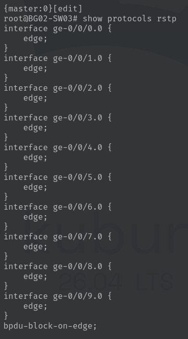

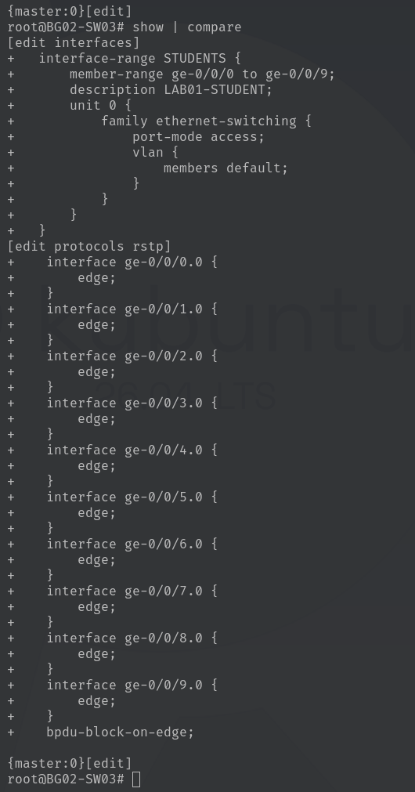

#### 2.2.4 Validate & Commit

```juniper
commit check
commit
```

#### 2.2.5 Verify Operational Configuration

```juniper
run show ethernet-switching interfaces
run show interfaces terse
```

**Verify the following**:

* Interfaces `ge-0/0/0` through `ge-0/0/9` are configured as access ports in VLAN 1
* All ten interfaces have the `LAB01-STUDENT` description
* RSTP identifies the student-facing interfaces as edge ports
* BPDU protection is configured
* No student-facing interface is administratively disabled

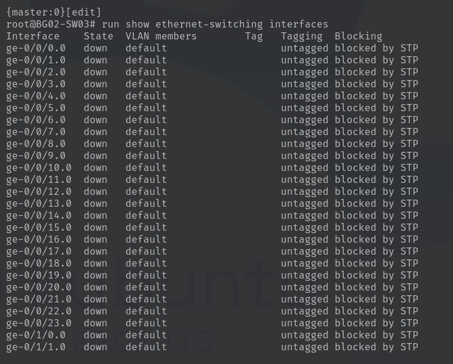

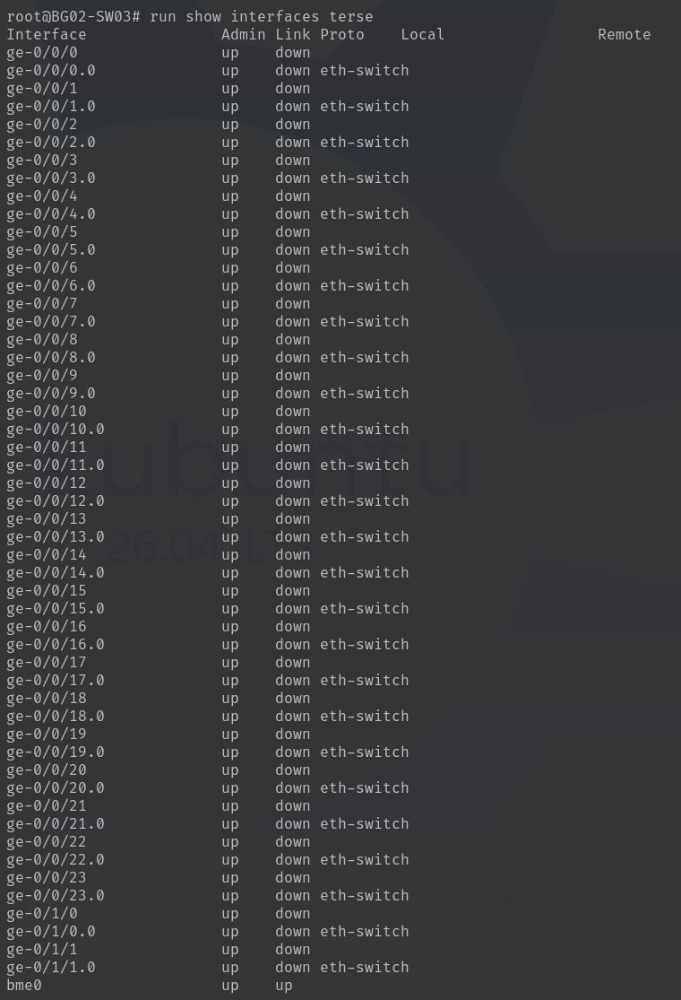

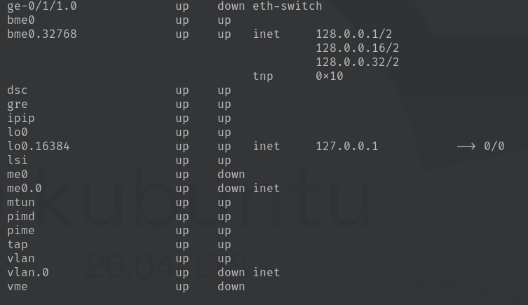

### 2.3 Disable Unused Interfaces

**Create an interface range**:

```juniper
set interfaces interface-range UNUSED-PORTS member-range ge-0/0/10 to ge-0/0/22
set interfaces interface-range UNUSED-PORTS description ADMIN-DOWN
set interfaces interface-range UNUSED-PORTS unit 0 family ethernet-switching port-mode access
set interfaces interface-range UNUSED-PORTS unit 0 family ethernet-switching vlan members BRICK
set interfaces interface-range UNUSED-PORTS disable
```

**Verify the pending configuration**:

```juniper
show interfaces interface-range UNUSED-PORTS
show | compare
```

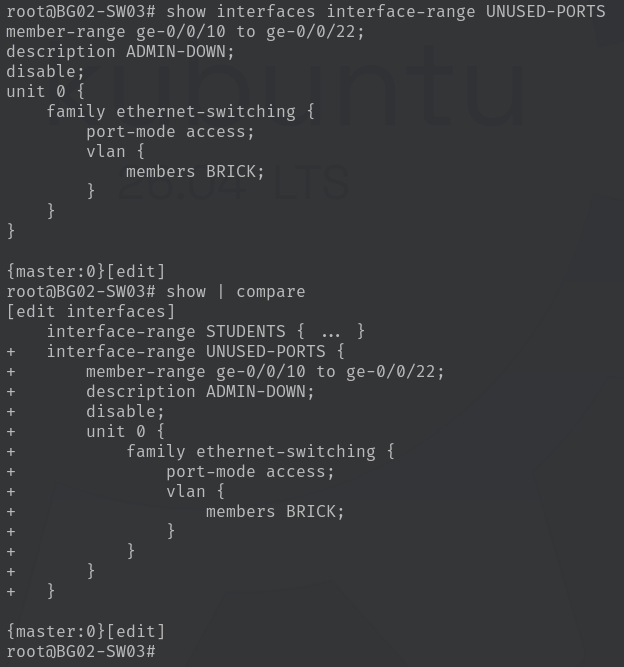

**Validate and commit**:

```juniper
commit check
commit
```

**Verify disabled interfaces**:

```juniper
run show interfaces terse | match ge-0/0/1
run show interfaces terse | match ge-0/0/2
run show vlans
run show ethernet-switching interfaces
```

The first two commands match interfaces beginning with `ge-0/0/1` and `ge-0/0/2`, including the unused ports. They are convenient for checking the range, although `ge-0/0/2` also matches student port 3.

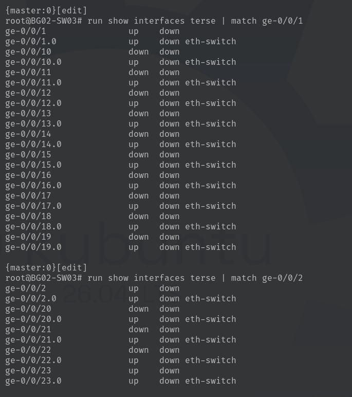

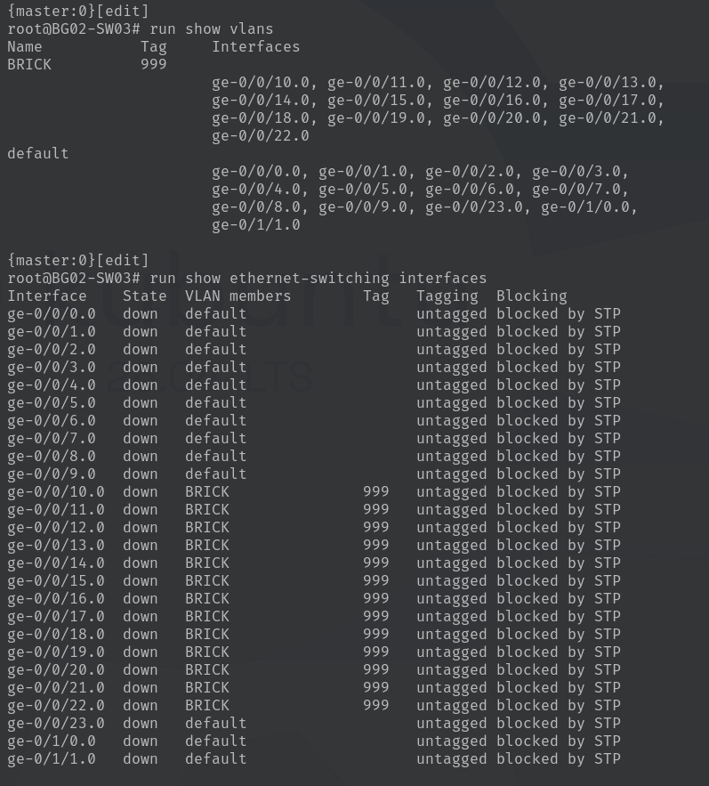

**Disable unused SFP+ uplink interfaces**:

```juniper
set interfaces ge-0/1/0.0 description ADMIN-DOWN
set interfaces ge-0/1/0.0 disable
set interfaces ge-0/1/1.0 description ADMIN-DOWN
set interfaces ge-0/1/1.0 disable
```

### 2.4 Reserve the TA Management Interface

Physical port 24 (`ge-0/0/23`) will serve as the dedicated TA management connection, equivalent to `Fa1/0/24` on the Cisco Catalyst 3750.

The interface will remain in `VLAN 1` because Lab 01 uses a single subnet. Additional management security, including SSH restrictions and MAC-based authorization, will be configured in Phase 3.

**Configure the management port**:

```juniper
set interfaces ge-0/0/23 description TA-MAN
set interfaces ge-0/0/23 unit 0 family ethernet-switching port-mode access
set interfaces ge-0/0/23 unit 0 family ethernet-switching vlan members default
```

**Configure RSTP protection**:

```juniper
set protocols rstp interface ge-0/0/23 edge
```

The global `bpdu-block-on-edge` setting configured earlier will also protect this interface.

**Verify the pending configuration**:

```juniper
show interfaces ge-0/0/23
show protocols rstp
show | compare
```

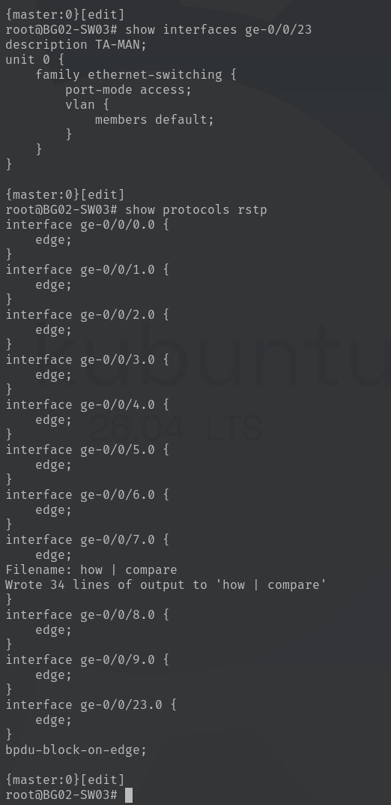

**Validate and commit**:

```juniper
commit check
commit
```

**Verify operational configuration**:

```juniper
run show interfaces terse ge-0/0/23
run show ethernet-switching interfaces
run show configuration interfaces ge-0/0/23
run show configuration protocols rstp
```

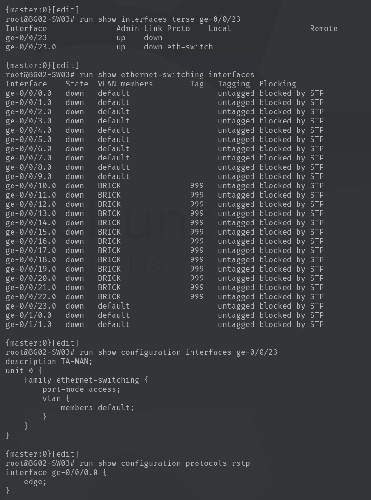

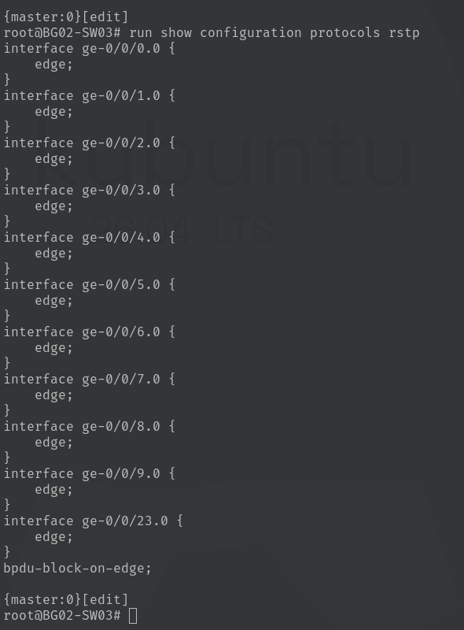

| Component | Expected Result |
| --- | --- |
| Interface | `ge-0/0/23` |
| Description | `TA-MAN` |
| Administrative State | Up |
| VLAN | `default` (VLAN 1) |
| Port Mode | Access |
| RSTP | Edge |
| BPDU Protection | Enabled |

> [!IMPORTANT]
> The TA port is not yet secured against unauthorized MAC addresses or SSH access. Do not treat the switch as deployment-ready until Phase 3 is complete.

### 2.5 Verify Interface Configuration

The Juniper EX3300 should now have **ten active student-facing interfaces, thirteen administratively disabled interfaces, one reserved TA management interface, and disabled SFP+ uplinks**.

**Verify VLAN assignments**:

```juniper
run show vlans
run show ethernet-switching interfaces
```

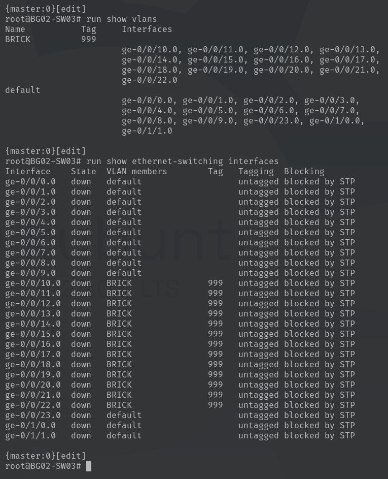

**Expected results**:

* VLAN `default` uses `VLAN ID 1`
* VLAN `BRICK` uses `VLAN ID 999`
* Student interfaces `ge-0/0/0` through `ge-0/0/9` belong to `default`
* TA interface `ge-0/0/23` belongs to default
* Disabled interfaces `ge-0/0/10` through `ge-0/0/22` are configured for `BRICK`

**Verify interface status**:

```juniper
run show interfaces terse | match ge-0/0/
```

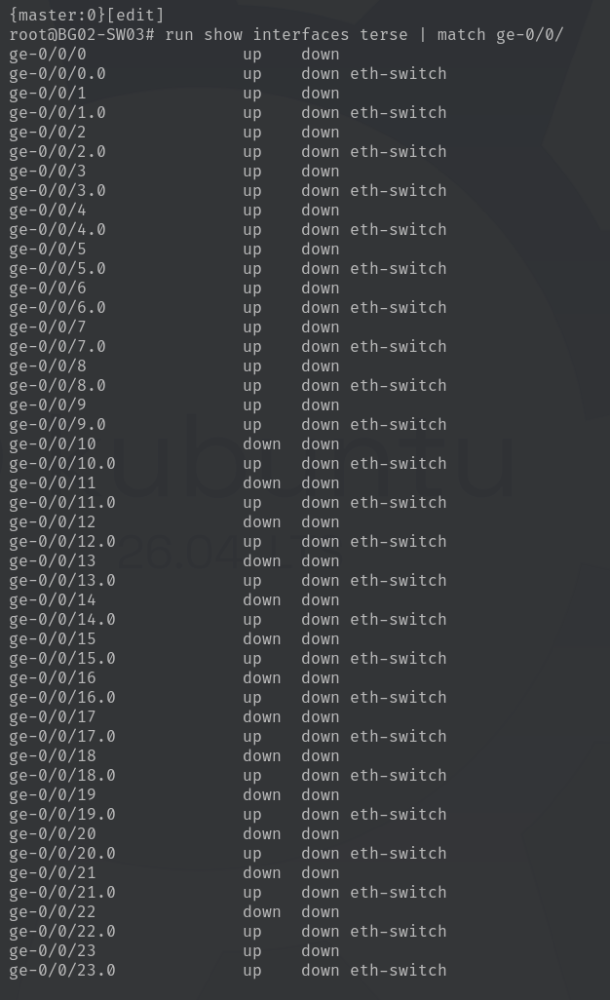

| **Interface(s)** | **Expected Admin** | **Expected Link** |
| --- | --- | --- |
| `ge-0/0/0-9` | up | up or down |
| `ge-0/0/10-22` | down | down |
| `ge-0/0/23` | up | up or down |

An administratively enabled interface with no Ethernet cable connected will normally show `up/down`.

**Verify the unused interface configuration**:

```juniper
show interfaces interface-range UNUSED-PORTS
```

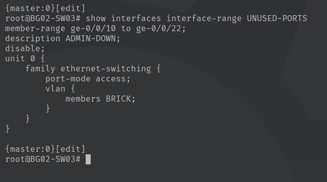

**Verify TA management interface**:

```juniper
run show configuration interfaces ge-0/0/23
run show configuration protocols rstp
```

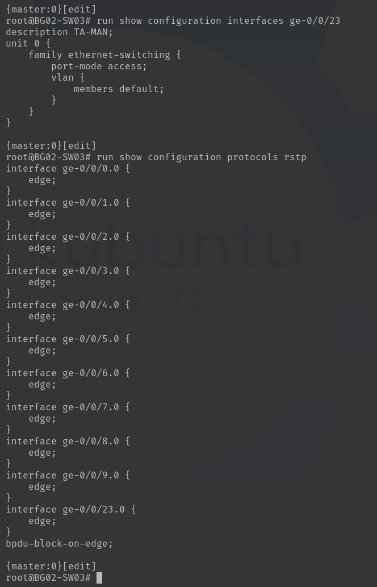

**Verify uplink isolation**:

```juniper
run show interfaces terse | match "ge-0/1/|xe-0/1/"
run show chassis hardware
```

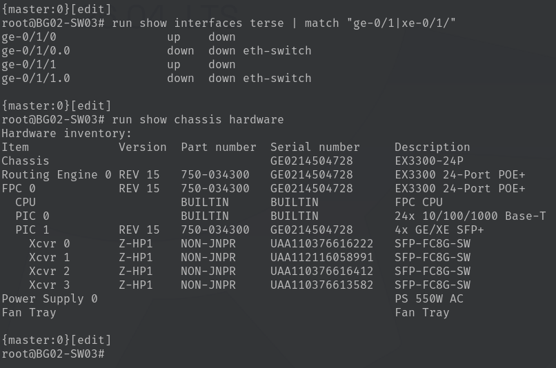

## Phase 3 — Management Interface & Access Security

Phase 2 is complete, so we're now configuring the EX3300's management IP, SSH authentication, and access restrictions.

### 3.1 Configure the Management Interface

The Juniper EX3300 uses a `Routed VLAN Interface (RVI)`, comparable to Cisco's Switch Virtual Interface (SVI).

Since we're running legacy JunOS 12.3R6.6, the management interface will be `vlan.0`, rather than the newer ELS `irb.0`.

**Configure the RVI**:

```juniper
delete interfaces vlan unit 0 family inet dhcp
set interfaces vlan unit 0 description LAB01-MAN
set interfaces vlan unit 0 family inet address 10.0.0.1/24
set vlans default l3-interface vlan.0
```

This assigns `10.0.0.1/24` to the switch on `VLAN 1`. **We are not enabling inter-VLAN routing or adding a default route**. All Lab 01 endpoints remain within `10.0.0.0/24`.

**Validate and commit**:

```juniper
commit check
commit
```

### 3.2 Configure SSH Authentication

Once the management interface commits successfully, **configure SSH and the TA account**.

```juniper
set system login user ta class super-user
set system login user ta authentication plain-text-password
```

Enter and confirm the password when prompted.

**Enable SSHv2**:

```juniper
set system services ssh protocol-version v2
set system services ssh connection-limit 5
set system services ssh root-login deny
```

This enables SSHv2, limits concurrent SSH connections, and prevents direct SSH login as root. The `ta` account retains administrative privileges.

**Configure login security**:

```juniper
set system login retry-options tries-before-disconnect 3
```

For the ten-minute inactivity timeout, **create a custom administrative login class**:

```juniper
set system login class TA-ADMIN permissions all
set system login class TA-ADMIN idle-timeout 10
set system login user ta class TA-ADMIN
```

This gives the TA account **full administrative permissions while enforcing an idle session timeout**.

**Verify and Commit**:

```juniper
show system login user ta
show system login class TA-ADMIN
show system services ssh
show | compare

commit check
commit
```

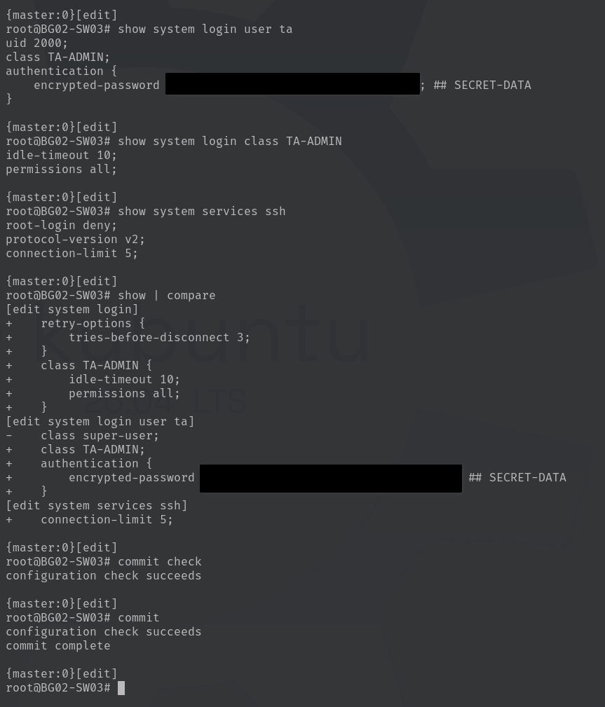

### 3.3 Restrict SSH to Authorized TA IP Addresses

On JunOS, we'll use a firewall filter applied to the switch's `lo0.0` interface. This protects traffic destined for the Routing Engine, rather than filtering student traffic passing through the switch:

```juniper
set interfaces lo0 unit 0 family inet
set firewall family inet filter RE-PROTECT term ALLOW-TA-SSH from source-address 10.0.0.250/32
set firewall family inet filter RE-PROTECT term ALLOW-TA-SSH from protocol tcp
set firewall family inet filter RE-PROTECT term ALLOW-TA-SSH from destination-port ssh
set firewall family inet filter RE-PROTECT term ALLOW-TA-SSH then accept

set firewall family inet filter RE-PROTECT term DENY-OTHER-SSH from protocol tcp
set firewall family inet filter RE-PROTECT term DENY-OTHER-SSH from destination-port ssh
set firewall family inet filter RE-PROTECT term DENY-OTHER-SSH then discard

set firewall family inet filter RE-PROTECT term ALLOW-OTHER then accept
set interfaces lo0 unit 0 family inet filter input RE-PROTECT
```

> [!CAUTION]
> JunOS 12.3R6.6 Compatibility: The EX3300 rejects the count action in the ingress Routing Engine firewall filter with the error Referenced filter 'RE-PROTECT' can not be used as count not supported on ingress.
>
> To maintain compatibility, the DENY-OTHER-SSH term uses discard without a packet counter.

The firewall filter uses `10.0.0.250/32` rather than the /24 subnet mask configured on the management interface. These serve two different purposes.

The management interface uses `10.0.0.1/24` to establish connectivity within the `10.0.0.0/24` subnet. However, **the SSH firewall filter uses /32 to match one specific host address (10.0.0.250)**, rather than permitting every device within the subnet.

The `ALLOW-OTHER` term is important. It prevents the filter's implicit deny from blocking other traffic to the switch, including student pings. This filter intentionally restricts only SSH. It is not a comprehensive control-plane protection policy.

> [!NOTE]
> The /32 restriction applies only to source-address matching in the SSH firewall filter. The switch and TA workstation retain their /24 interface subnet masks. Source-IP filtering provides an additional layer of security but does not prevent IP address

**Verify & Commit**:

```juniper
show firewall family inet filter RE-PROTECT
show interfaces lo0

show | compare

commit check
commit
```

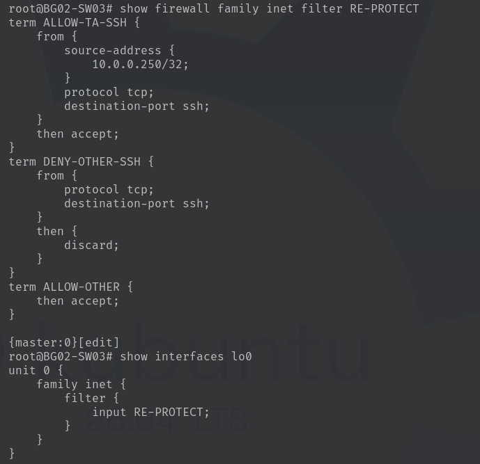

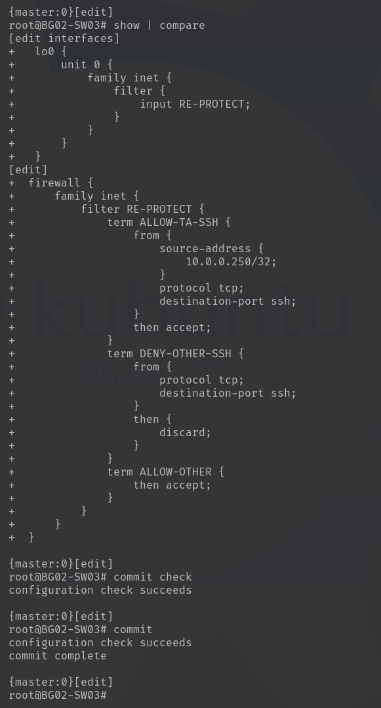

### 3.4 Configure TA Management Port MAC Security

The objective is to authorize three designated TA Ethernet adapters, reject traffic from unauthorized MAC addresses, and keep the management port operational rather than shutting it down after a violation.

**Configure MAC-Based port security**:

```juniper
set ethernet-switching-options secure-access-port interface ge-0/0/23 allowed-mac aa:bb:cc:dd:ee:01
set ethernet-switching-options secure-access-port interface ge-0/0/23 allowed-mac aa:bb:cc:dd:ee:02
set ethernet-switching-options secure-access-port interface ge-0/0/23 allowed-mac aa:bb:cc:dd:ee:03
```

The MAC addresses above are examples only.

**Configure MAC limit**:

```juniper
set ethernet-switching-options secure-access-port interface ge-0/0/23 mac-limit 3 action drop
```

This configures a limit of three learned MAC addresses, using packet drop as the violation action.

> [!IMPORTANT]
> `allowed-mac` and `mac-limit` work together but are not interchangeable. **Allowed MAC addresses take precedence over dynamically learned addresses**. Therefore, we must physically test that an unauthorized fourth MAC cannot pass traffic; a successful commit alone is insufficient proof of strict allowlist enforcement.

```juniper
show ethernet-switching-options secure-access-port
show | compare

commit check
commit
```

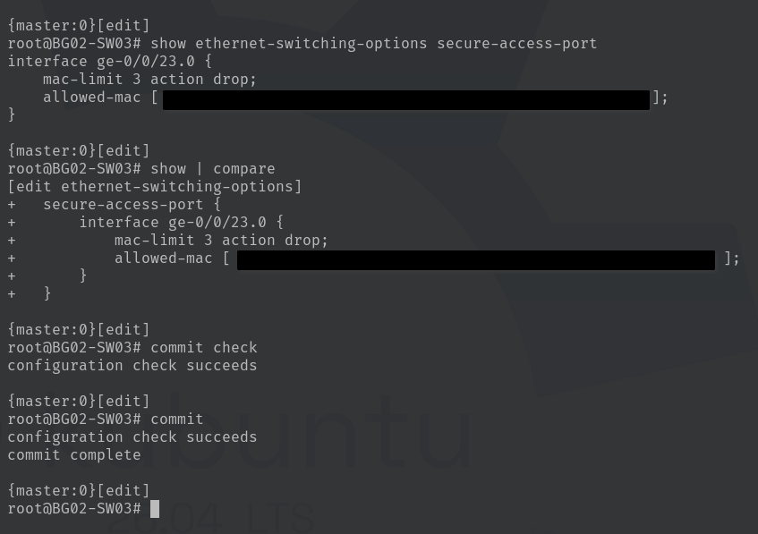

**Check for the following**:

| **Component** | **Expected Result** |
| --- | --- |
| Interface | `ge-0/0/23` |
| Allowed MAC | 3 TA MAC addresses |
| MAC limit | 3 |
| Violation Action | Drop |
| Authorized TA Connection | Successful |
| Unauthorized MAC | Traffic rejected, subject to physical validation |
| Port Status | Remains operational |

## Phase 4 — Configuration Persistence & Recovery

Unlike Cisco IOS, **JunOS saves the active configuration when you execute `commit`**. We'll also maintain a separate, named Lab 01 configuration snapshot.

### 4.1 Save the Active Configuration

Before creating the baseline, verify that the current candidate configuration has no pending changes.

```juniper
show | compare
```

If no differences appear, the candidate and committed configurations match.

**Then check**:

```juniper
run show system commit
```

**If there are pending changes, review them before committing**. Do not automatically commit unexpected configuration changes.

> [!NOTE]
> JunOS does not require Cisco's `copy running-config startup-config` command. Successfully committed configurations persist across switch reboots.

### 4.2 Create the Lab 01 Configuration Profile

JunOS supports saving a configuration snapshot to a named file:

```juniper
save /config/lab01.conf
```

**Verify the saved file**:

```juniper
run file list /config detail
```

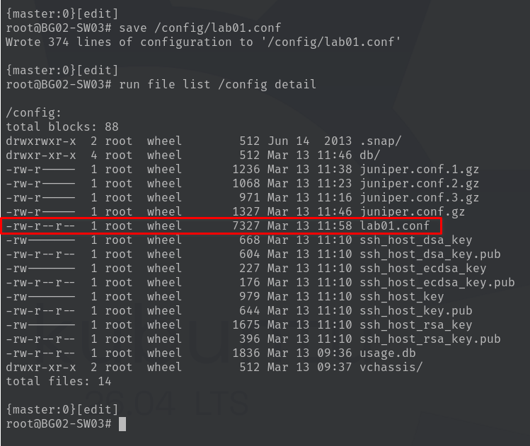

> [!IMPORTANT]
> Save this file **only after verifying the final Lab 01 configuration**. The file should represent a known-good deployment state, not simply the latest working configuration.

### 4.3 Restore a Stored Lab Configuration

To restore the Lab 01 baseline, enter configuration mode and **load the saved configuration**:

```juniper
configure
load override /config/lab01.conf
```

Unlike `load merge, load override` **replaces the entire candidate configuration** with the contents of the saved profile. This prevents settings from later labs from remaining in the configuration unintentionally.

**Verify & Commit**:

```juniper
show | compare
commit check
commit
```

A reboot is not required.

> [!NOTE]
> `load override` replaces the candidate configuration, potentially including user accounts, SSH settings, and management IP addresses. Keep console access available during restoration and confirm the configuration only after verifying connectivity.

### 4.4 Establish External Configuration Backups

Although internal flash storage enables local recovery, it should not be the sole copy of the switch configuration.

Each verified lab profile should also be retained in the project's version-controlled configuration repository, excluding passwords, credential hashes, private keys, and other secrets.

```text
configs/
  3750/
    lab01.cfg
    lab02.cfg
    lab03.cfg
  2960/
    lab01.cfg
    lab02.cfg
    lab03.cfg
  juniper/
    lab01.conf
    lab02.conf
    lab03.conf
```

**Export the configuration**:

From operational mode, or with run from configuration mode:

```juniper
show configuration | display set | no-more
```

Copy the output into the repository's configuration file. Before committing it to Git, **redact authentication hashes and inspect for other secrets**, including SNMP communities and cryptographic key material.

> [!NOTE]
> Remember that the sanitized repository file is documentation, not an exact restoration backup.

### 4.5 Verify Configuration Persistence

Confirm the saved configuration exists and check the active configuration:

```juniper
run file list /config detail
run show configuration system host-name
run show configuration interfaces vlan
run show configuration vlans
```

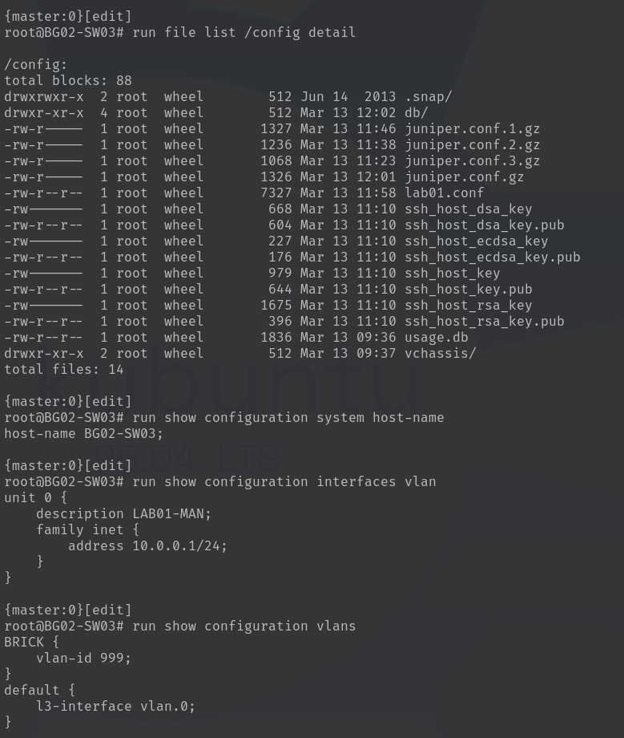
