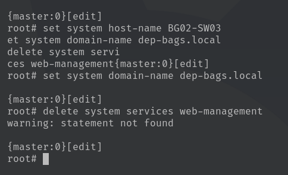
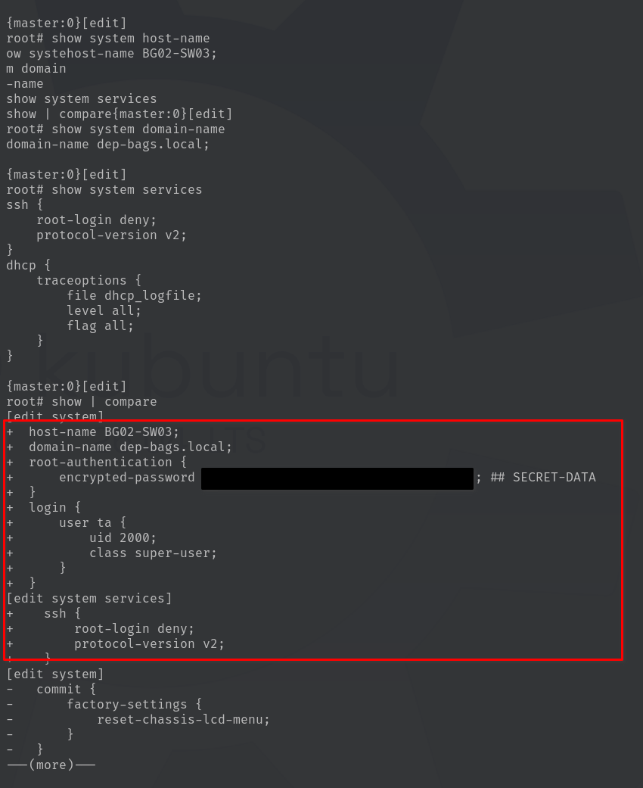
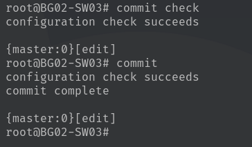

# Lab 01 - Juniper EX3300 PoE+ Configuration

| Property | Value |
| --- | --- |
| Switch | Juniper EX3300-24P |
| Inventory IDs | SW03, SW04 |
| Hostnames | BG02-SW03, BG02-SW04 |
| JunOS Version | 12.3R6.6 |
| Chassis Serial # | GE0214504728 |
| Access Interfaces | 24 GigabitEthernet |
| Uplink Interfaces | 4 10GE SFP+ |
| Management | SSHv2, restricted |

## Phase 1 - Base System Configuration

The start of the setup will cover the `switch's identity and fundamental operating settings`. Following the base configuration, this documentation will cover the interface configuration, management security, and configuration-storage procedure for the **Juniper EX3300**.

### 1.1 Configure Switch Identity

Each switch will receive a unique hostname for identification during admin and troubleshooting workflows. The hostname will differ from the InventoryID by also including the bag in which the switch resides.

The naming convention is `BG##-SW##`, where `BG` identifies the deployment bag number, and `SW` defines the switch number. That way we will have an aggregation of bag location & switch number to quickly identify the switch in question.

Dependant on which switch it being set up, **use the hostname `BG02-SW03` or `BG02-SW04`:

```juniper
cli
configure
set system host-name BG02-SW03
set system domain-name dep-bags.local
delete system services web-management
```



> [!NOTE]
> The `delete system services web-management` command is needed only if that stanza exists; a message that the statement does not exist is harmless. Likewise, do not enable Telnet. Junos uses password hashes rather than Cisco `service password-encryption`, and no Cisco `enable secret` equivalent is needed for a `super-user` account. Routing is not configured for Lab 01; do not configure IP routing on additional VLAN interfaces or a default route.

### 1.2 Configure Root Authentication

**JunOS requires root authentication to be configured before the first configuration commit can succeed**. Unlike Cisco IOS, where administrative privileges are controlled through enable mode, JunOS uses user accounts with assigned login classes.

**While in configuration mode**:

```juniper
set system root-authentication plain-text-password
```

When prompted, enter and confirm a strong password. The password will not be displayed while typing.

> [!IMPORTANT]
> Root authentication is mandatory on an initially unconfigured Juniper EX3300. Attempting to commit without it will produce the error `Missing mandatory statement: 'root-authentication'`.

---

> [!CAUTION]
> Do not include plaintext credentials or password hashes in published documentation. Store administrative credentials using the project's approved secure credential-storage process.

### 1.3 Verify Base Configuration

Before committing, **inspect the pending system configuration**:

```juniper
show system host-name
show system domain-name
show system services
show | compare
```

**Expected output**:



**Verify that**:

* The `hostname` matches the assigned switch: `BG02-SW03` or `BG02-SW04`
* The domain name is `dep-bags.local`
* HTTP and HTTPS web management services are not enabled
* Root authentication has been configured

**Validate the pending configuration**:

```juniper
commit check
```

**Expected output**:

```juniper
configuration check succeeds
```

If the configuration is correct, confirm the commit:

```juniper
commit
```

**Expected output**:

```juniper
commit complete
```



> [!NOTE]
> Unlike Cisco IOS, **JunOS does not maintain independently edited running and startup configurations**. Changes are made to a candidate configuration and activated using commit. Successfully committed changes persist across a reboot.

## Phase 2
