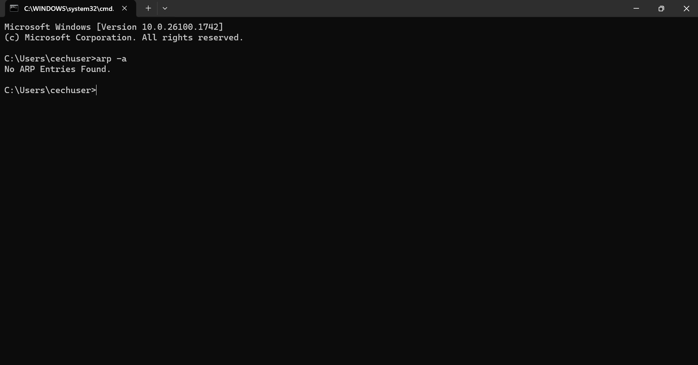
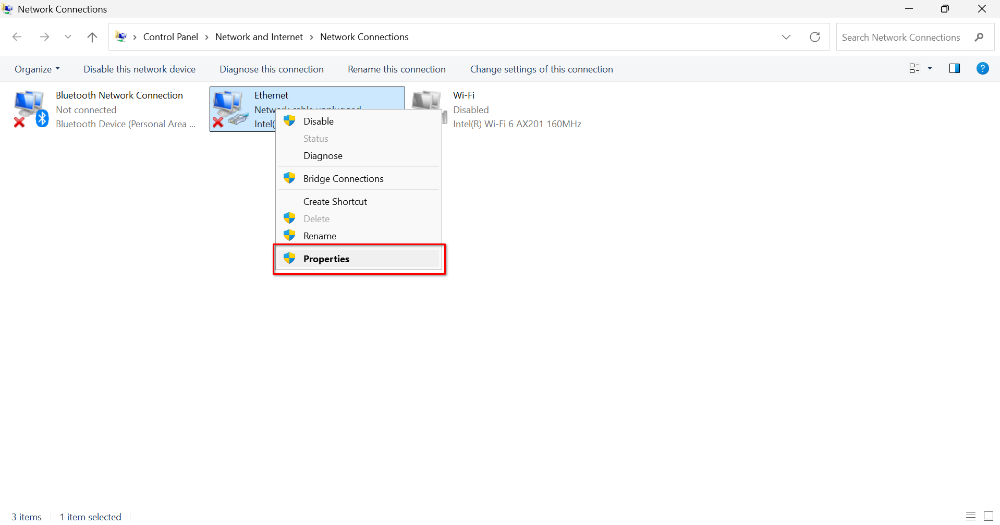
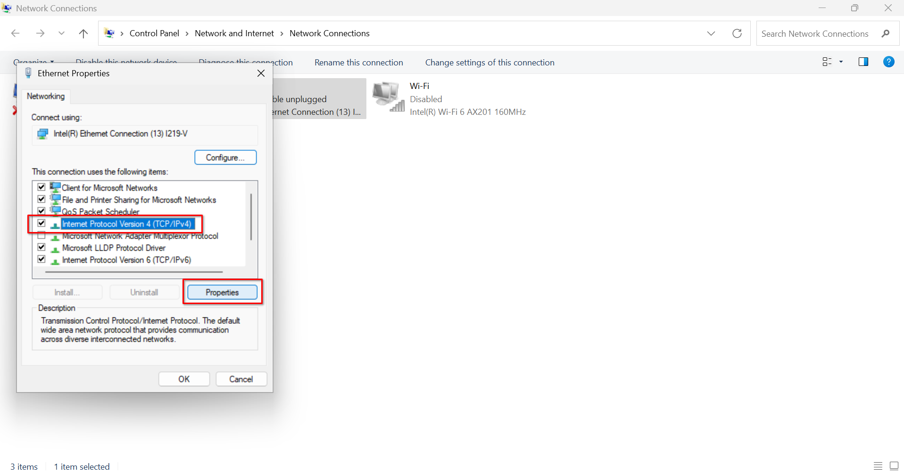
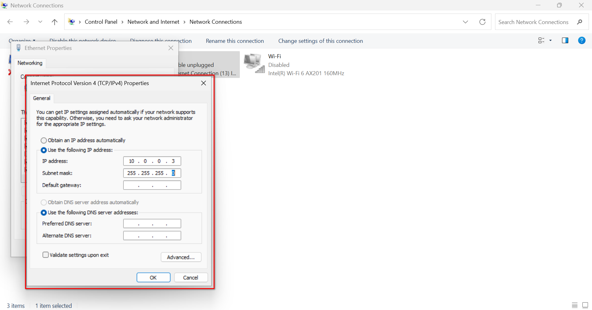

<!-- markdownlint-disable-next-line MD026 -->
# Lab 01: Build It. Connect It. Play.

<!-- markdownlint-disable-next-line MD036 -->
**IT1080C Computer Networking | Physical Networking Lab**


Your first challenge is to deploy a local area network, configure your computer's IPv4 settings, and establish a connection to a locally hosted game server.

---

## Important Rules

1. Use only the equipment assigned to your group.
2. **Do not** connect your lab network to UC_Secure or campus Ethernet outlets.
3. **Do not** modify switch configurations unless specifically instructed.
4. Keep cables organized and avoid unnecessary equipment disconnections.
5. Notify your TA or instructor if equipment is damaged or behaving unexpectedly.

### What You'll Learn

Through deployment activities, you'll gain practical experience with:

- Ethernet connections and physical networking
- IPv4 addressing and subnet masks
- Communication between devices on a local network
- Basic networking commands (ping, arp)
- Locally hosted services

## What You'll Accomplish

By the end of this lab, you should be able to:

- Identify and connect physical networking equipment.
- Configure a static IPv4 address and subnet mask.
- Establish communication with another device on the same LAN.
- Access a locally hosted web application.

---

## The Challenge

Your mission is simple: **build a working network and use it to access a local game server.**

The games are hosted on a Raspberry Pi inside your deployment bag. To access them, you'll need to connect and configure your laptop. No Internet connection is required.

> **[SCREENSHOT NEEDED — 01]** LAN Games home screen. This should be the first major visual students see, before the technical instructions.

---

## Part 1 - Get to Know Your Environment

### Step 1: Identify Your Equipment

Before connecting anything, take a look at your deployment bag. If anything is missing, tell your TA or instructor **before** continuing.

| Equipment | Purpose |
| --- | --- |
| Laptop | Your computer on the network |
| Switch | Connect devices on the LAN |
| Raspberry Pi | Host lan-games server |
| Ethernet Cables | Carry data between devices |

### Step 2: Log In

Turn on your assigned laptop, log in with these credentials:

**Username:** `cechuser`
**Password:** `Pa$$w0rd`

### Step 3: First ARP Check

Before connecting the laptop into the network, run the first `arp` command:

**Press `Windows + R`, type `cmd`, and press Enter:


**Run:**

```powershell
arp -a
```



You should not see any learned entries for the lab's switch or server.

> [!NOTE]
> ARP (Address Resolution Protocol) helps your computer match IPv4 addresses with physical addresses (MAC addresses). Before your laptop can send data to another device on the LAN, it has to learn that device's MAC address. It does this using the **Address Resolution Protocol (ARP)**.

---

## Part 2 - Deploy Your Network

### Step 4: Connect Your Equipment

1. Position your deployment bag at your workstation
2. Connect your laptop to its assigned switch port using an Ethernet cable
3. Verify that all equipment is turned on and the Ethernet link lights are active.

**Laptop Assignments:**

| Switch | Port 1 | Port 2 | Port 3 |
| --- | --- | --- | --- |
| SW01 | PC01 | PC02 | PC03 |
| SW02 | PC04 | PC05 | PC06 |
| SW03 | PC07 | PC08 | PC09 |
| SW04 | PC10 | PC11 | PC12 |

> [!IMPORTANT]
> Do not connect your deployment bag to UC's production network or any classroom wall Ethernet outlet. Do not modify switch or server configurations.

### Step 5: Check ARP Again

**Run:**

```powershell
arp -a
```

You should still see no learned entries for the switch or server.

Your laptop is physically connected, but it hasn't been configured to communicate on the lab's IPv4 network.


---

## Part 3 - Configure Your Laptop

### Step 6: Assign IPv4 Address

**Press `Windows + R`, type `ncpa.cpl`, press Enter:**


**Right click `Ethernet` and select `Properties`:**



You will be **prompted to enter your password** in order to enter privileged mode. Enter the same login password, `Pa$$w0rd`.

**Select `Internet Protocol Version 4 (TCP/IPv4)`, and then `Properties`:**



Choose `Use the following IP address`. **Enter the IP address corresponding to your *assigned switch port*:**

| Switch Port | IPv4 Address |
| --- | --- |
| 1 | 10.0.0.3 |
| 2 | 10.0.0.4 |
| 3 | 10.0.0.5 |

**Use these additional settings:**

| Setting | Value |
| --- | --- |
| Subnet mask | 255.255.255.0 |
| Default Gateway | *Leave blank* |
| DNS servers | *Leave blank* |

Click **OK** to save your changes.



### Step 7: Verify IPv4 Configuration

**Return to Command Prompt and run:**

```powershell
ipconfig

arp -a
```

Confirm that your Ethernet adapter displays the correct IPv4 address and subnet mask. You should still have no learned entries for the switch or server.

Your laptop now has an IPv4 address, but you haven't intentionally communicated with either device yet.

> **[SCREENSHOT NEEDED]** both ipconfig and arp showing

---

## Part 4 - Test Your Network

### Step 8: Ping the Switch

**Run:**

```powershell
ping 10.0.0.1
```

You should receive replies from the switch.

> **[SCREENSHOT NEEDED]** ping to switch

### Step 9: Ping the Server

**Run:**

```powershell
ping 10.0.0.254
```

You should receive replies from the Raspberry Pi.

> **[SCREENSHOT NEEDED]** ping to server

### Step 10: Check ARP One Last Time

**Run:**

```powershell
arp -a
```

You should now see entries similar to these:

| Internet Address | Physical Address |
| --- | --- |
| `10.0.0.1` | Switch MAC Address |
| `10.0.0.254` | Server MAC Address |

Your laptop *used ARP to discover the MAC addresses* needed to communicate with these devices.

> **[SCREENSHOT NEEDED]** ARP check showing outputs to switch and server

### Why Can You Ping this Switch?

In Packet Tracer, you previously worked with switches that didn't have an IP address configured.

Those switches could forward network traffic, but you couldn't ping the switches themselves.

**This lab uses a managed switch with its own IP address (10.0.0.1)**. This allows you to communicate with the switch directly.

---

## Part 5 - Connect to lan-games

### Step 11: Open the Server

**Open your web browser and enter:**

```powershell
http://10.0.0.254
```

What happens?

Your browser uses port 80 by default for HTTP, but **LAN Games is running on a different port**.

### Step 12: Find the Right Port

**Now enter:**

```powershell
http://10.0.0.254:3000
```

You should see the LAN Games homepage!

The IP address identifies the server. The port number (3000) identifies the service you want to access.

> **[SCREENSHOT NEEDED]** loaded lan-games page

---

## Part 6 - Submit & Play

### Step 13: Complete the Quiz

On your **personal laptop**:

1. Open Canvas
2. Find the Lab 01 lan-games quiz
3. Answer both questions and submit

### Step 14: Game Time

Once you've submitted your quiz, you're free to play LAN Games with your classmates for the remainder of the class.

**You've successfully deployed, configured, and tested a physical local area network**.

### Step 15: Clean-up Checklist

- [ ] Close your browser and command-line windows.
- [ ] Unplug power adapters, then Ethernet cables.
- [ ] Coil cables loosely and return everything to your bag.
- [ ] Change your laptop's IPv4 setting back to **Automatic (DHCP)**
