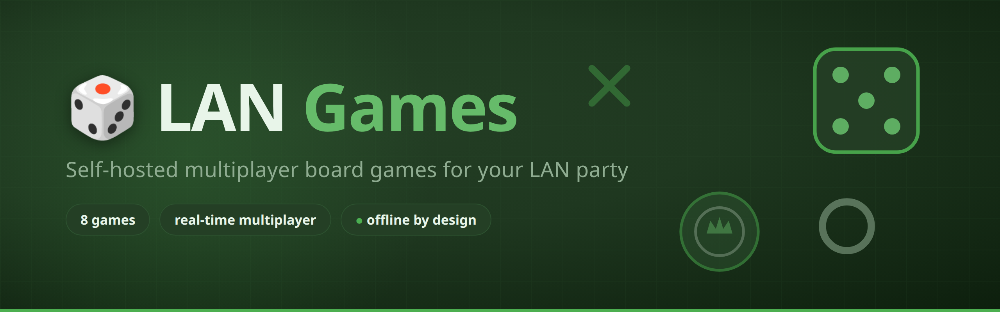

# Deployment Bags
<!-- markdownlint-disable-next-line MD001 MD026 -->
### Real hardware. Real networks. Hands-on learning.

Welcome to the University of Cincinnati's **Deployment Bags** project.

These portable, isolated networking environments give you the opportunity to apply classroom concepts using physical networking equipment.

Instead of relying entirely on simulation, you'll build connections, configure devices, and observe how real networks behave.

## Featured Lab — LAN Games

**Lab 01: Build It. Connect It. Play.**

Your first challenge is to deploy a local area network, configure your computer's IPv4 settings, and establish a connection to a locally hosted game server.

Once connected, open:
<!-- markdownlint-disable-next-line MD034 -->
**http://10.0.0.254:3000**

The server runs LAN Games, an interactive collection of network-accessible games hosted entirely within your lab environment.

**[Start Lab 01](Lab-01)**

## Lab Resources

| Resource | Description |
| --- | --- |
| [Getting Started](Getting-Started) | Equipment, safety, and lab preparation |
| [Lab 01](Lab-01) | Deployment and gameplay walkthrough |
| [Troubleshooting](Lab-01#troubleshooting) | Common connectivity problems |

---
<!-- markdownlint-disable-next-line MD036 -->
*IT1080C Computer Networking · University of Cincinnati*
